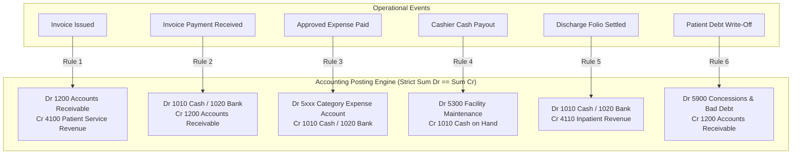
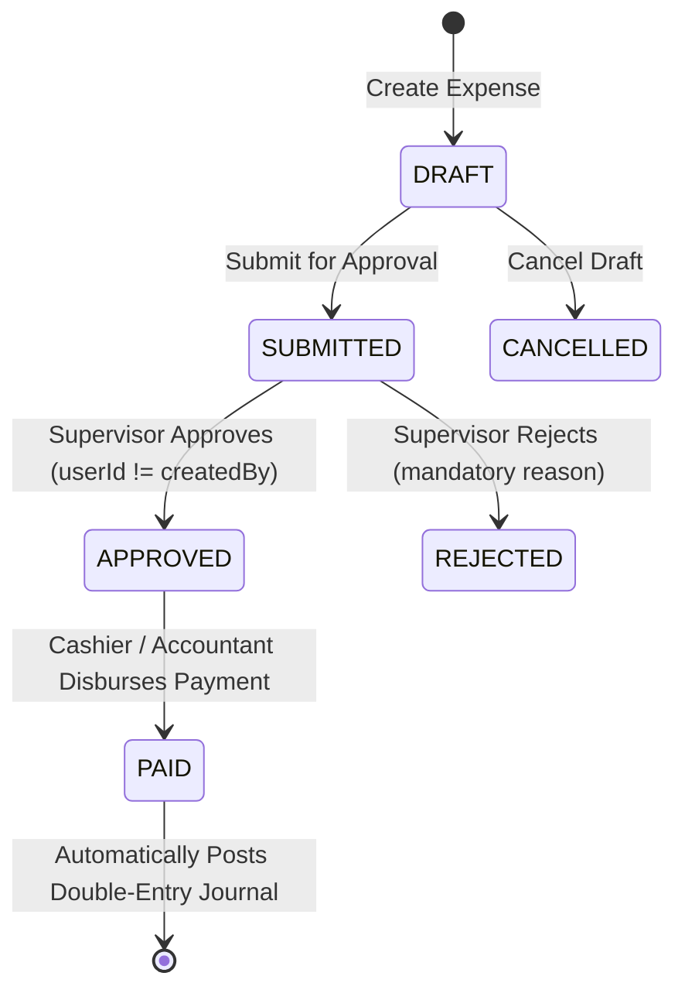

# Medora 2.0 — General Accounting, Chart of Accounts & Expense Ledger Migration Mapping

## 1. Executive Summary & Legacy Audit

This document defines the architecture and migration plan for **Phase 20: General Accounting, Chart of Accounts & Expense Ledger**, transitioning legacy ICTHospital financial record keeping, account sectors, income/expense logging, and expense categories into Medora 2.0's enterprise double-entry accounting ledger.

### 1.1 Legacy Implementation Artifacts
- **Controllers**:
  - `legacy/app/Http/Controllers/AccountingController.php` (572 lines): Handled account sector creation, single-entry accounting income/expense logging, filtering by sector and date range, printing voucher receipts, and computing aggregate balance.
- **Models**:
  - `legacy/app/Models/Accounting.php` (`table = 'accounting'`): Single-entry cashbook records (`id`, `name`, `sector`, `category` enum `'income'|'expense'`, `description`, `amount`, `date`, `receipt_no`, `user_id`, `created_at`, `updated_at`).
  - `legacy/app/Models/AccountSector.php` (`table = 'accounting_sector'`): Flat sectors (`id`, `name`, `type` enum `'income'|'expense'`, `status`, `created_at`, `updated_at`).
  - `legacy/app/Models/AccountingSetting.php` (`table = 'accounting_settings'`): Flat key-value table, historically holding an unmigrated single row intended for external accounting synchronization.
  - `legacy/app/Models/Expense.php` (`table = 'expense'`): Simple expense tracking (`id`, `expense_category_id`, `name`, `amount` stored as `varchar(100)`, `note`, `date`, `created_at`, `updated_at`).
  - `legacy/app/Models/ExpenseCategory.php` (`table = 'expense_category'`): Expense classifications (`id`, `name`, `description`, `created_at`, `updated_at`).
- **Blade Views**:
  - `legacy/resources/views/app/accounting/index.blade.php`: Listing single-entry transactions with date/sector filters and totals.
  - `legacy/resources/views/app/accounting/create.blade.php`: Modal/form to record ad-hoc income or expense.
  - `legacy/resources/views/app/accounting/print.blade.php`: Print voucher for accounting slips.
  - `legacy/resources/views/app/accounting/sector.blade.php`: Sector management table.
  - `legacy/resources/views/app/accounting/settings.blade.php`: Settings configuration interface.
- **Permissions**:
  - `accounting_view`, `accounting_add`, `accounting_update`, `accounting_delete`, `expense_view`, `expense_add`, `expense_update`, `expense_delete`.

---

## 2. Legacy vs Medora 2.0 Behavioral Gap Analysis

| Feature | Legacy ICTHospital (`AccountingController.php`) | Medora 2.0 (`AccountingModule`) |
| :--- | :--- | :--- |
| **Ledger System** | Single-entry cashbook. Recorded either "income" or "expense" with a single amount and sector string. | **Strict Double-Entry General Ledger**. Every transaction has balanced debit and credit entries ($\sum \text{Debit} = \sum \text{Credit}$). |
| **Chart of Accounts** | Flat, unstructured `accounting_sector` strings without accounting codes, normal balances, or parent-child hierarchy. | **Hierarchical Chart of Accounts (COA)** with standard numeric codes (1000–5000), account types (Asset, Liability, Equity, Revenue, Expense), and normal balance definitions. |
| **Financial Integrity** | No mathematical balance assertion. Could record expenses or income out of thin air. Amounts in `expense` stored as `varchar(100)`. | Strict decimal(14,2) precision. Every posted journal entry cryptographically/mathematically asserts $\sum \text{Debit} == \sum \text{Credit}$. |
| **Journal Immutability** | Users could arbitrarily update or delete historical accounting records. | **Strict immutability**. Posted journal entries cannot be edited or deleted. Adjustments require explicit signed reversal entries (`REVERSED` status, linked `reversedEntryId`). |
| **Accounting Periods** | None. Any user could record transactions with historical or future dates indefinitely. | **Accounting Periods** (`OPEN`, `CLOSING`, `CLOSED`). Transactions can only be posted into `OPEN` periods. Closed periods lock historical books. |
| **Expense Lifecycle** | Direct insert into `expense` table without approvals, validation, or ledger integration. | Formal multi-stage workflow: `DRAFT` &rarr; `SUBMITTED` &rarr; `APPROVED` &rarr; `PAID` (or `REJECTED`, `CANCELLED`). Dual-control approval (separation of duties). |
| **Operational Integration** | Siloed. Invoices, cashier shifts, lab tests, and inpatient folios had zero automated linkage to accounting. | **Automated Posting Integration**. Invoices, cashier settlements, cash payouts, and inpatient discharges generate balanced journal entries via `AccountingPostingService`. |
| **Financial Reporting** | Simple table sum of income vs expense. No Trial Balance, Balance Sheet, or General Ledger drill-down. | Full Financial Statement suite: **Trial Balance**, **Profit & Loss (Income Statement)**, **Balance Sheet**, **General Ledger**, **Expense Summary**, and **Cash & Bank Liquidity**. |
| **Idempotency** | Duplicate clicks caused duplicate income/expense entries. | Enforced unique `idempotencyKey` on all posting calls. |

---

## 3. Financial Ownership Boundaries

Medora 2.0 maintains strict separation of concerns across financial modules:

| Module | Core Responsibility | Accounting Interaction |
| :--- | :--- | :--- |
| **InvoiceModule** | Billing, charge capture, patient invoices, payments, discounts. | Triggers receivable recognition and revenue posting when an invoice is issued or paid. |
| **CashierModule** | Cash drawer management, physical counting, shift opening/closing, treasury reconciliation. | Shift opening float, cash payouts, and drawer variances post directly to Cash on Hand and designated expense/settlement accounts. |
| **InpatientModule** | Bed allocation, admission folios, daily accommodation charges. | Accrues inpatient revenue and posts final discharge settlements. |
| **Pharmacy / Lab / Radiology** | Clinical dispensing, tests, and imaging charges. | Charges feed into Patient Invoices, which then post to their respective Revenue accounts (4120, 4130, 4140). |
| **StaffModule** | Staff profiles, departments, designations. | Submitter and approver identity for expense workflows. |
| **AccountingModule (Phase 20)** | **Central General Ledger**. Chart of Accounts, Journal Entries, Period Locks, Expenses, Financial Reports. | **Master of Financial Record**. Holds the canonical double-entry ledger for the entire hospital. |

---

## 4. Standard Chart of Accounts (COA) Catalogue

Medora 2.0 seeds a comprehensive, GAAP/IFRS-aligned hospital Chart of Accounts:

### 1000 — ASSETS (Normal Balance: DEBIT)
- **1010**: Cash on Hand (Hospital Vault & Cashier Drawers)
- **1020**: Bank Account — Operating Account
- **1030**: Bank Account — Treasury & Capital Account
- **1200**: Accounts Receivable — Patients & Corporate Panels
- **1300**: Medical & Pharmaceutical Inventory
- **1400**: Prepaid Expenses & Advances
- **1500**: Medical Equipment & Machinery
- **1510**: Accumulated Depreciation — Medical Equipment

### 2000 — LIABILITIES (Normal Balance: CREDIT)
- **2010**: Accounts Payable — Vendors & Suppliers
- **2020**: Accrued Payroll & Salaries Payable
- **2030**: Patient Deposits & Advances (Unearned Inpatient Revenue)
- **2040**: Statutory Withholding & Tax Payable

### 3000 — EQUITY (Normal Balance: CREDIT)
- **3010**: Hospital Retained Earnings
- **3020**: Hospital Capital & Endowment Fund

### 4000 — REVENUE (Normal Balance: CREDIT)
- **4100**: Patient Service Revenue — Outpatient & Consultations
- **4110**: Inpatient Accommodation & Nursing Care Revenue
- **4120**: Pharmacy & Pharmaceutical Sales Revenue
- **4130**: Laboratory Diagnostic Services Revenue
- **4140**: Radiology & Medical Imaging Revenue
- **4200**: Other Operating Revenue & Administrative Fees

### 5000 — EXPENSES (Normal Balance: DEBIT)
- **5100**: Medical & Surgical Consumables Expense
- **5200**: Utilities Expense (Electricity, Water, Internet, Gas)
- **5300**: Hospital Maintenance, Facility & Biomedical Repairs
- **5400**: Staff Training, Licensure & Administrative Expense
- **5500**: Facility Rent & Building Leases
- **5600**: Housekeeping, Cleaning & Waste Disposal Expense
- **5900**: Concessions, Patient Discounts & Bad Debt Expense

---

## 5. Automated Journal Posting Rules

Every financial event maps to a balanced double-entry journal entry:

---

## 6. Expense Management Lifecycle & Separation of Duties

### Separation of Duties Enforced:
1. Submitter cannot approve their own expense: `expense.createdBy !== approverUserId`.
2. Only users with `ACCOUNTING_EXPENSE_APPROVE` or `SUPERVISOR` role can approve.
3. Once marked `PAID`, the system generates an immutable Journal Entry (`sourceModule = 'EXPENSE'`) crediting Cash/Bank and debiting the associated Expense Account.

---

## 7. Accounting Period Closing Procedure

1. **Validation**: Check that no unposted draft journals exist for the period.
2. **Reconciliation**: Confirm that Total Debits equal Total Credits across all posted journals in the period.
3. **Closing**: Mark `AccountingPeriod` status as `CLOSED`, record `closedAt` and `closedBy`.
4. **Lockout**: Any subsequent attempt to post a journal entry with `accountingDate` falling inside a closed period is strictly rejected with `HTTP 409 Conflict`.
5. **Reopening**: Only authorized administrators with `ACCOUNTING_PERIOD_REOPEN` can reopen a closed period, logging full audit records.

---

## 8. Financial Reporting Engine

- **Trial Balance**:
  $$\sum \text{Debit Balances} = \sum \text{Credit Balances}$$
  Asserts ledger equilibrium across all Asset, Liability, Equity, Revenue, and Expense accounts.
- **Profit & Loss (Income Statement)**:
  $$\text{Net Operating Income} = \sum \text{Revenue Accounts (4xxx)} - \sum \text{Expense Accounts (5xxx)}$$
- **Balance Sheet**:
  $$\text{Total Assets} = \text{Total Liabilities} + \text{Total Equity} + \text{Current Period Net Income}$$
- **General Ledger**:
  Complete chronological audit trail for any selected account, showing opening balance, line-item debits/credits, running balance, and source transaction references.
- **Expense Summary**:
  Breakdown of hospital expenditures by category, department, and vendor.
- **Cash & Bank Liquidity**:
  Daily cashbook summary showing opening cash float, collections, disbursements, and closing liquidity.

---

## 9. RBAC & Security Matrix

| Role | COA View | COA Edit | Journal View | Journal Post | Journal Reverse | Expense Submit | Expense Approve | Expense Pay | Period Close | Reports View |
| :--- | :---: | :---: | :---: | :---: | :---: | :---: | :---: | :---: | :---: | :---: |
| **Super Admin** | [x] | [x] | [x] | [x] | [x] | [x] | [x] | [x] | [x] | [x] |
| **Finance Manager / Accountant** | [x] | [x] | [x] | [x] | [x] | [x] | [x] | [x] | [x] | [x] |
| **Cashier / Staff** | [ ] | [ ] | [ ] | [ ] | [ ] | [x] | [ ] | [ ] | [ ] | [ ] |
| **Department Head / Supervisor** | [x] | [ ] | [x] | [ ] | [ ] | [x] | [x] | [ ] | [ ] | [x] |
| **Doctor / Nurse** | [ ] | [ ] | [ ] | [ ] | [ ] | [ ] | [ ] | [ ] | [ ] | [ ] |

---

## 10. Backward Compatibility

To maintain 100% legacy audit fidelity:
- Legacy single-entry tables `accounting`, `accounting_sector`, and `accounting_settings` are mapped in Prisma schema as `AccountingLegacy`, `AccountSectorLegacy`, and `AccountingSetting`.
- All legacy data can be queried or imported into the modernized double-entry Chart of Accounts seamlessly.

