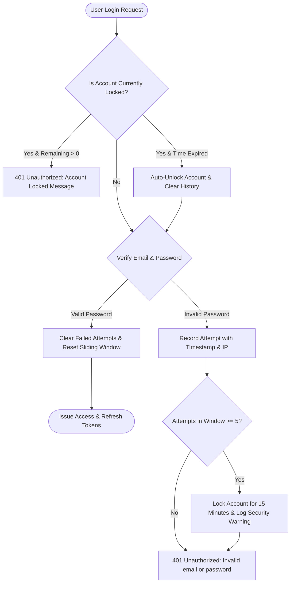

# Medora 2.0 — Authentication Security & Credential Protection Policy

**Document Version:** 1.0.0  
**Phase:** Remediation Stage 1  
**Scope:** Authentication Engine, Credential Storage, Account Lockout, and Password Recovery  

---

## 1. Password Storage & Transparent Hash Migration

1. **Modern Standard**: Argon2id via `argon2` npm library. Default configuration utilizes:
   - Type: Argon2id (resistant against both GPU side-channel and memory-tradeoff attacks)
   - Memory cost: 65,536 KiB (64 MiB)
   - Time cost: 3 iterations
   - Parallelism: 4 threads
2. **Legacy Interoperability & Transparent Migration**:
   - Medora 1.0 stored user credentials using Laravel bcrypt (`$2y$` prefix).
   - `AuthService.verifyPassword` detects `$2y$` hashes and verifies them using `bcryptjs`.
   - On valid authentication of a legacy hash, `AuthService.login` transparently re-hashes the plaintext password with Argon2id and updates the user's record in PostgreSQL.

---

## 2. Brute-Force Defense: Account Lockout Policy

Implemented via `AccountLockoutService` (`backend/src/modules/auth/account-lockout.service.ts`):



### Policy Parameters:
- **Maximum Consecutive Failures**: 5 failed attempts.
- **Sliding Observation Window**: 15 minutes (900,000 ms).
- **Lockout Duration**: 15 minutes (900,000 ms).
- **Auto-Unlock**: Immediate upon expiration of lockout window without requiring database administrator intervention.
- **Administrative Manual Unlock**: Supported via `unlock(email)` in `AccountLockoutService`.

---

## 3. Ephemeral Password Reset Protocol

Implemented via `PasswordResetService` (`backend/src/modules/auth/password-reset.service.ts`):

1. **Anti-Enumeration Protection**:
   `POST /api/v1/auth/forgot-password` unconditionally returns HTTP 200:
   ```json
   {
     "message": "If an active account exists for that email, password reset instructions have been issued."
   }
   ```
   This prevents automated probing of employee email addresses.
2. **Cryptographic Token Issuance**:
   - Raw token: 32 cryptographically secure random bytes generated via `crypto.randomBytes(32).toString('hex')` (64-character entropy).
   - Storage: Only the SHA-256 hash (`crypto.createHash('sha256').update(token).digest('hex')`) is retained in memory.
   - Expiration: Strictly 15 minutes.
3. **Consumption & Invalidation**:
   `POST /api/v1/auth/reset-password`:
   - Hashes incoming raw token with SHA-256 and checks against active tokens.
   - Rejects expired or unrecognized tokens.
   - Automatically deletes token from store upon first use (single-use constraint).
   - Hashes new password with Argon2id and updates `user.password`.
   - Revokes all active refresh sessions (`userSession.updateMany({ where: { userId }, data: { isRevoked: true } })`) to force all active devices to re-authenticate.

---

## 4. Session Security & Refresh Token Rotation

1. **Refresh Token Hashing**: Plaintext refresh tokens are never persisted in PostgreSQL. The database stores only SHA-256 hashes (`refreshTokenHash`).
2. **Single-Use Rotation**: Every `/auth/refresh` invocation revokes the submitted refresh token and issues a new active token with updated cryptographic family tracking.
3. **Replay & Reuse Detection**: If a previously revoked refresh token is presented, the system detects a session hijacking attempt, immediately revokes all tokens within that session family, and emits a high-priority security audit log.
