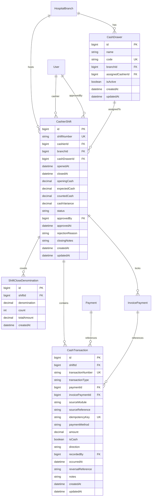
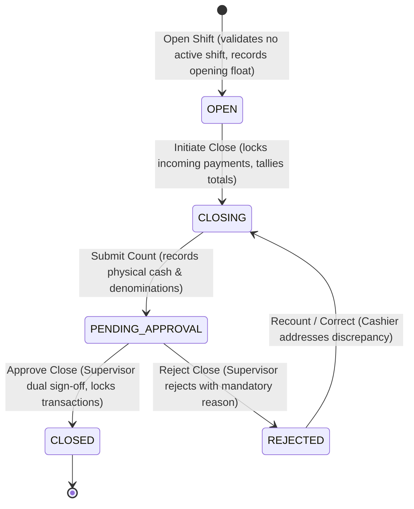

# Medora 2.0 — Cashier, Shift Close & Treasury Settlement Migration Mapping

## 1. Executive Summary & Legacy Audit

This document defines the architecture and migration plan for **Phase 18: Cashier, Shift Close & Treasury Settlement**, transitioning legacy ICTHospital cash collection, shift closure, and day-book reporting into Medora 2.0.

### 1.1 Legacy Implementation Artifacts
- **Controller**: `legacy/app/Http/Controllers/CashController.php` (316 lines)
- **Model**: `legacy/app/Models/ShiftClose.php` (`table = 'shift_close'`)
- **Helper**: `legacy/app/Support/PaymentModes.php` (Modes: Cash, Bank transfer, Card, Cheque, Online; Write-off: 'Write-off')
- **Views**:
  - `legacy/resources/views/app/cash/close.blade.php`: Shift cash count, totals by payment bucket, open payments table, closing form.
  - `legacy/resources/views/app/cash/slip.blade.php`: Printable shift close receipt slip with breakdown and handover signatures.
  - `legacy/resources/views/app/cash/daybook.blade.php`: Department-wise summary by patient group (Private, Panel, Charity), doctor vs hospital share, payment collections by mode, CSV export.
  - `legacy/resources/views/app/cash/settlement.blade.php`: Multi-invoice settlement across all open patient bills, oldest first, with optional audited write-offs.
- **Tests**: `legacy/tests/Feature/CashTest.php` (165 lines, 8 test cases)
- **Permissions**: `cash_close`, `cash_close_all_users`, `view_payment_reports`, `payment_add`, `payment_update`.

---

## 2. Legacy vs Medora 2.0 Behavioral Gap Analysis

| Feature | Legacy ICTHospital (`CashController.php`) | Medora 2.0 (`CashierModule`) |
| :--- | :--- | :--- |
| **Shift Opening** | Implicit: shift began whenever a payment was recorded with `shift_close_id = null`. | Explicit: Cashier opens shift (`OPEN`) with optional drawer selection and opening cash float (`openingCash`). |
| **Opening Float** | Untracked (assumed $0.00). | Formally tracked and audited as an initial `OPENING_FLOAT` transaction in the cashier ledger. |
| **Shift Ownership & Isolation** | Cashier sees own open payments; supervisor with `cash_close_all_users` can view/close anyone's. | Cashier can only transact and close their own active shift; supervisor with `CASHIER_CLOSE_ALL_USERS` or supervisor role can inspect/approve/reject any shift. |
| **Concurrent Active Shifts** | Implicit per user; multiple concurrent unclosed payments allowed across sessions. | Strictly at most 1 active shift (`OPEN`, `CLOSING`, `PENDING_APPROVAL`) per cashier. |
| **Payment Modes** | 5 buckets (`cash`, `bank_transfer`, `card`, `cheque`, `other`) + `write_off` (excluded from money). | Preserved 100%. `isCash = true` strictly for physical Cash; non-cash modes are tracked in totals but excluded from physical drawer cash calculation. |
| **Physical Cash Counting** | Single input `counted_cash`. | Supports single `countedCash` plus structured denomination counts (`ShiftCloseDenomination`). |
| **Expected Cash Calculation** | `expectedCash = sum(cash_payments)`. | `expectedCash = openingFloat + sum(cash_payments) - sum(cash_refunds) - sum(cash_payouts) + sum(cash_adjustments)`. |
| **Variance Calculation** | `difference = counted_cash - total_cash`. | `variance = countedCash - expectedCash`. Discrepancies require closing notes if nonzero. |
| **Dual-Control Approval** | Single step: cashier or supervisor executed `POST /cash-close`, immediately finalizing. | Formal dual-control state machine: `OPEN` &rarr; `CLOSING` &rarr; `PENDING_APPROVAL` &rarr; `CLOSED` (or `REJECTED` &rarr; `CLOSING`). Separation of duties enforced. |
| **Refunds & Cash Payouts** | Ad-hoc or untracked in drawer close. | Formally recorded as `CASH_PAYOUT` or `REFUND` transactions linked to shift and authorizing user. |
| **Patient Final Settlement** | Applies money to oldest open invoices first; allows write-offs with mandatory clinical/administrative reason. | Preserved 100% in `POST /api/v1/cashier/settlement/:patientId` with database row-level locking. |
| **Day Book Reporting** | Date range, patient bucket (Private/Panel/Charity), user, department, service, doctor vs hospital share, CSV export. | Preserved 100% in `GET /api/v1/cashier/day-book` with rich analytics and CSV download. |

---

## 3. Database Architecture (Prisma & Supabase PostgreSQL)

### 3.1 Existing Schema Baseline
The baseline migration `0_init/migration.sql` established:
- `payment`: Invoice header.
- `invoice_payment`: Installment payment rows (`amount`, `method`, `reference`, `paid_at`, `received_by`, `shift_close_id`).
- `shift_close`: Historical close records.

### 3.2 Phase 18 Schema Additions (`20261102200000_phase_18_cashier`)

---

## 4. Shift Lifecycle & State Machine

### Invariants:
1. **At most one active shift per cashier**: A cashier cannot open a new shift if they have an existing shift in `OPEN`, `CLOSING`, or `PENDING_APPROVAL` status.
2. **Separation of Duties**: Cashier cannot approve their own shift unless they possess `CASHIER_CLOSE_ALL_USERS` and system configuration permits supervisor self-close override.
3. **Pessimistic Concurrency**: Shifting from `OPEN` to `CLOSING` and approving `PENDING_APPROVAL` to `CLOSED` acquires `SELECT id FROM cashier_shifts WHERE id = ... FOR UPDATE`.
4. **Physical Cash Isolation**: Only payments with `method = 'Cash'` contribute to physical drawer cash. Card, Bank transfer, Cheque, Online, and Write-off are tracked in separate non-cash buckets.

---

## 5. Cross-Module Financial Integrations

### 5.1 Outpatient Invoicing (`InvoiceModule`)
- Recording an invoice payment via `POST /api/v1/invoices/:id/pay` records an `InvoicePayment` and synchronously creates an auditable `CashTransaction` in the cashier's active shift if one is open.
- The `idempotencyKey` prevents duplicate transaction entries: `INV-PAY-<invoicePaymentId>`.

### 5.2 Pharmacy, Laboratory & Radiology
- Outpatient pharmacy dispensing, lab requisitions, and radiology orders raise invoices in `InvoiceModule` with status `unpaid` or `paid`.
- Only when money is collected does an `InvoicePayment` occur, which posts a `CashTransaction` to the cashier's shift. Unpaid orders or requisitions do not generate cash transactions.

### 5.3 Inpatient Admissions Folio (`InpatientModule`)
- Charges posted to `InpatientFolio` (bed, pharmacy, lab, imaging) represent accrued hospital debt, not cash collections.
- When an inpatient folio is settled via `POST /api/v1/inpatient/admissions/:id/folio/settle` or final discharge settlement, the collected payment is recorded against the cashier's active shift with `sourceModule = 'INPATIENT_FOLIO'`, `idempotencyKey = FOL-SETTLE-<admissionId>-<timestamp>`.
- Folio charges are never counted as cash receipts until settled.

---

## 6. Granular RBAC Permissions

| Permission | Legacy Equivalent | Role Mapping | Capability |
| :--- | :--- | :--- | :--- |
| `cashier_view` | `cash_close` | Accountant, Receptionist, Admin | View active shift, drawer status, open payments |
| `cashier_shift_open` | `cash_close` | Accountant, Receptionist, Admin | Open a new cashier shift with opening float |
| `cashier_shift_close` | `cash_close` | Accountant, Receptionist, Admin | Submit shift count and initiate close |
| `cashier_shift_approve` | `cash_close_all_users` | Accountant, Admin | Review and approve pending shift closures |
| `cashier_shift_reject` | `cash_close_all_users` | Accountant, Admin | Reject shift closure with mandatory explanation |
| `cashier_transaction_view` | `cash_close` | Accountant, Receptionist, Admin | View shift transaction audit ledger |
| `cashier_cash_payout` | `payment_update` | Accountant, Admin | Authorize petty cash payouts and refunds |
| `cashier_cash_adjust` | `payment_update` | Accountant, Admin | Authorize drawer cash float adjustments |
| `cashier_reconciliation_view`| `cash_close_all_users` | Accountant, Admin | Access cross-cashier drawer variance reports |
| `cashier_daybook_view` | `view_payment_reports` | Accountant, Admin | Access financial day book and CSV export |
| `cash_close_all_users` | `cash_close_all_users` | Accountant, Admin | Access and manage any cashier's shift |

---

## 7. Verification Strategy
1. **Disposable PostgreSQL Rehearsal**: Execute migrations against clean schema; verify foreign keys and constraints.
2. **Unit Tests**: Full unit test coverage for shift state machine, variance math, separation of duties, and non-cash exclusion.
3. **E2E PostgreSQL Tests**: Test full lifecycle from shift opening to final supervisor approval, multi-invoice patient settlement, concurrency race conditions, and inpatient folio settlement.
4. **Build & Lint**: 0 TypeScript and ESLint errors across backend and frontend.
