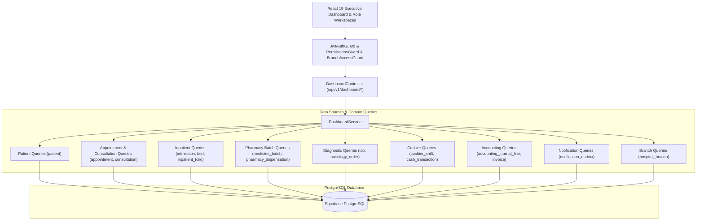

# Dashboard & Operational Analytics Architecture
## Medora 2.0 | Phase 23 Architecture Document

## 1. Executive Summary & Core Objectives
Medora 2.0 Phase 23 provides a unified, secure, branch-aware Executive Dashboard and Operational Analytics engine aggregating real-time clinical, operational, financial, and inventory data across all 22 migrated hospital domains.

### Key Tenets:
1. **Real PostgreSQL Data Sources Only**: Zero mock or fabricated metrics. All counts, ratios, turnaround times, and financial sums derive from authentic database relations.
2. **Strict Server-Side Branch Scoping**: Non-global users can only see analytics bounded to their assigned branch. Cross-branch metrics are completely shielded from unauthorized inspection.
3. **Role-Appropriate Dashboards**:
   - **Executive / Super Admin**: Hospital-wide overview, multi-branch comparisons, financial performance, bed occupancy, department workloads, operational alerts, and notification queue status.
   - **Branch Admin**: Same operational overview strictly scoped to active branch.
   - **Doctor**: Clinical workload, assigned patients, today's appointments, pending/completed consultations.
   - **Receptionist**: Front-desk operations, appointments, waiting patients, admissions/discharges.
   - **Pharmacist**: Authorized batch inventory levels, low-stock alerts, near-expiry inventory, dispensing volume.
   - **Laboratorist / Radiologist**: Diagnostic worklists, pending specimens, unverified results, studies in progress.
   - **Cashier / Accountant**: Cash drawer shifts, pending treasury reconciliation, cash vs. non-cash collections, and General Ledger summaries.
4. **Single Source of Truth**:
   - Financial totals derive directly from `AccountingModule` (General Ledger journals) and `CashierModule` (Drawer shifts and transactions).
   - Inventory alerts derive directly from `PharmacyModule` authoritative batch ledger (`medicine_batch`).
   - Occupancy derives from `InpatientModule` (`admission`, `bed`, and `bed_allocation_history`).

---

## 2. Architectural Diagram

---

## 3. Metric Aggregation Strategy & Performance
- **Optimized SQL Aggregations**: Queries utilize `COUNT(*)`, `SUM()`, `AVG()`, and `GROUP BY` with indexed timestamp and foreign key filters (`createdAt`, `branchId`, `status`) to avoid transporting bulky entity rows over the wire.
- **Strict Date Range Windows**: Shared filter parser standardizes date boundaries (`today`, `yesterday`, `last7Days`, `last30Days`, `currentMonth`, `custom`) using UTC boundaries.
- **Zero Drift Protection**: No separate denormalized reporting tables or external BI dependencies are introduced. The live database remains authoritative.
