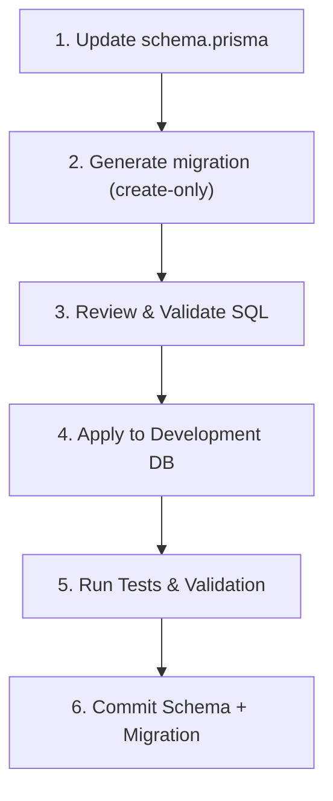

# Medora 2.0 — Database Change Management & Migration Runbook

## 1. Overview & Policy Principles

This runbook establishes the canonical change management procedures for Supabase PostgreSQL in Medora 2.0.

### Core Rules:
1. **No `prisma db push` on Shared or Production Environments**:
   - `npx prisma db push` is restricted to local scratch experimentation.
   - All shared, staging, and production database modifications must be executed through versioned, peer-reviewed SQL migrations managed by Prisma Migrate.
2. **Atomic Schema and Migration Commits**:
   - Every change to `backend/prisma/schema.prisma` must be accompanied by its corresponding migration SQL under `backend/prisma/migrations/<timestamp>_<name>/migration.sql` in the same Git commit.
3. **Dual Connection String Architecture**:
   - **`DATABASE_URL`**: Connects through Supavisor connection pooler (port 6543, transaction mode) for NestJS runtime HTTP requests.
   - **`DIRECT_URL`**: Connects directly to PostgreSQL (port 5432, session mode) to support PostgreSQL advisory locks required by Prisma Migrate.
4. **Zero-Loss Baseline Guarantee**:
   - The initial baseline migration is established at `backend/prisma/migrations/0_init/migration.sql`. No migration may drop or overwrite existing patient records or historical ledgers.

---

## 2. Standard Migration Lifecycle for Future Phases

Whenever a future hospital module requires schema additions or alterations, follow this 6-step lifecycle:



### Step 1: Update `schema.prisma`
Modify model definitions, relations, indexes, or enums in `backend/prisma/schema.prisma`. Validate schema syntax:
```bash
npm run prisma:validate
```

### Step 2: Generate Migration SQL (Draft Mode)
Generate the migration SQL file without immediately applying it:
```bash
npx prisma migrate dev --name <feature_name> --create-only
```
This generates a new directory: `backend/prisma/migrations/<timestamp>_<feature_name>/migration.sql`.

### Step 3: Review & Edit Generated SQL
Inspect the generated SQL before execution:
- Verify that table and column names use exact casing and snake_case mapping (`@map`).
- Check that constraints and indexes have descriptive names.
- Verify that no unintended table drops or column erasures are generated.
- If data backfill or custom SQL casting is required, edit `migration.sql` directly.

### Step 4: Apply Migration
Apply the migration to the active development database:
```bash
npx prisma migrate dev
```
In automated deployment or CI environments, use:
```bash
npx prisma migrate deploy
```

### Step 5: Test & Validate
1. Regenerate typed Prisma Client:
   ```bash
   npm run prisma:generate
   ```
2. Verify migration status:
   ```bash
   npx prisma migrate status
   ```
3. Run the complete automated test suite:
   ```bash
   npm test
   npm run test:e2e
   ```

### Step 6: Commit
Commit both `backend/prisma/schema.prisma` and `backend/prisma/migrations/` together:
```bash
git add backend/prisma/schema.prisma backend/prisma/migrations/
git commit -m "phase-X: add <feature> database migration"
```

---

## 3. Safe Handling of Common Schema Changes

| Change Type | Risk Level | Required Safe Procedure |
| :--- | :--- | :--- |
| **New Column Addition** | Low | New columns on existing tables must be declared as **nullable** (`String?`) or provide an explicit default value (`@default(...)`). Adding a non-null column without a default will fail on tables containing existing rows. |
| **Column Rename** | Medium | Prisma generates `DROP COLUMN` and `ADD COLUMN` when a field is renamed, which destroys existing production data. Replace generated DDL with: `ALTER TABLE "table" RENAME COLUMN "old_name" TO "new_name";`. |
| **Data Type Conversion** | High | Converting types (e.g. `varchar` to `bigint` or `decimal`) requires an explicit `USING` clause: `ALTER TABLE "prescription" ALTER COLUMN "patient" TYPE BIGINT USING ("patient"::BIGINT);`. |
| **Foreign Key Addition** | Medium | Before applying `ADD CONSTRAINT ... FOREIGN KEY`, verify that no orphaned child records exist in the table. If orphans exist, resolve or reassign them in an initial data cleanup statement. |
| **Index Creation** | Low / Medium | On large production tables, standard `CREATE INDEX` acquires a share lock. Use `CREATE INDEX CONCURRENTLY` in custom SQL migrations if adding indexes to multi-million-row production tables. |
| **Table Deletion / Deprecation** | High | Never drop a table in a single deployment. Phase 1: Deprecate entity in code. Phase 2: Archive data. Phase 3: Execute `DROP TABLE` after sign-off. |

---

## 4. Verification & Diagnostic Commands

### Check Schema Validation:
```bash
npx prisma validate --schema=prisma/schema.prisma
```

### Check Migration Status:
```bash
npx prisma migrate status
```
Expected output on a healthy database:
```
1 migration found in prisma/migrations
Database schema is up to date!
```

### Check for Drift Between Schema and Database:
```bash
npx prisma migrate diff --from-schema prisma/schema.prisma --to-config-datasource
```
Expected output:
```
No difference detected.
```

### Mark a Baseline Migration as Applied (Baseline Workflow Only):
```bash
npx prisma migrate resolve --applied <migration_name>
```

### Mark a Failed Migration as Rolled Back:
```bash
npx prisma migrate resolve --rolled-back <migration_name>
```

---

## 5. Applied Migration Registry

| Migration Directory | Applied Date | Target Scope | Models & Changes Introduced |
| :--- | :--- | :--- | :--- |
| `0_init/migration.sql` | 2026-10-31 | Baseline Schema | 39 core hospital models, sequences, keys, and indexes |
| `20261031120000_phase_12_medicine_catalogue` | 2026-10-31 | Phase 12: Medicine Catalogue | Modernized `medicine` table, normalized foreign keys, `medicine_category`, `manufacturer`, `dosage_form`, `measurement_unit`, `supplier` |
| `20261031140000_phase_13_pharmacy_inventory` | 2026-10-31 | Phase 13: Pharmacy & Inventory | Batch management (`medicine_batch`), audit ledger (`stock_movement`), procurement (`purchase_order`, `purchase_order_item`, `goods_receipt`, `goods_receipt_item`), dispensing (`pharmacy_dispensation`, `pharmacy_dispensation_item`), adjustments (`stock_adjustment`, `stock_adjustment_item`), returns (`pharmacy_return`, `pharmacy_return_item`), and `prescription_medicine.dispensed_quantity` |

