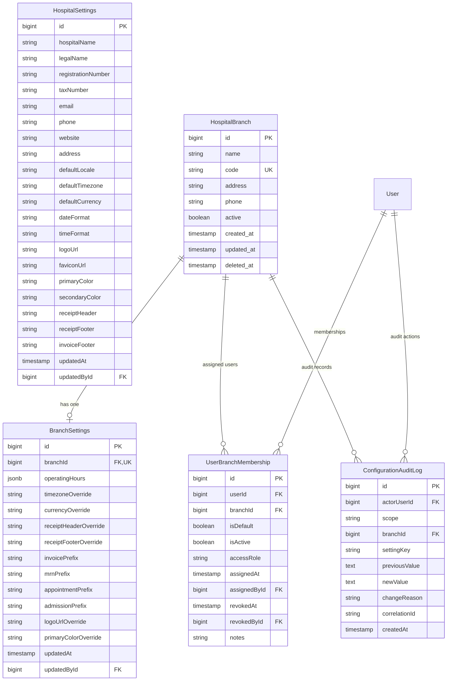

# Hospital Settings and Multi-Branch Architecture
## Medora 2.0 — Phase 21 Specification

### 1. Architectural Overview & Design Rationale
Medora 2.0 modernizes the legacy hospital configuration and branch operations. In the legacy monolithic application (`settings`, `website_settings`, `hospital_branch`, `BranchController.php`), settings were stored in a flat, unversioned single-row table with zero branch overrides, zero change auditing, and hard-coded session-based branch switching that overwrote `users.branch_id`.

Phase 21 introduces an enterprise-grade, branch-aware, auditable configuration architecture:
1. **Hospital-Wide Canonical Identity & Defaults (`HospitalSettings`)**:
   - Single institutional profile managing legal, tax, contact, and system defaults.
   - Defines system baseline: locale, timezone (`Asia/Karachi`), currency (`PKR`), date/time formatting, branding assets.
2. **Branch Entity & Lifecycle (`HospitalBranch`)**:
   - Independent operational facilities with unique codes, contact points, active/inactive lifecycle, and soft deletion.
   - Inactive branches reject operational transactions and user logins.
3. **Branch-Level Operational Overrides (`BranchSettings`)**:
   - 1-to-1 extension table for each branch.
   - Granular overrides for operational hours, timezone, currency, document prefixes (`INV-`, `MRN-`, `APT-`, `ADM-`), and branch-specific receipt headers/footers and branding.
4. **Three-Tier Settings Inheritance Resolution**:
   - `EffectiveSettings = Branch Override ?? Hospital Setting ?? System Default`.
   - Downstream clinical, billing, and cashier modules query effective settings without duplicating fallback logic.
5. **Configuration Change Auditing (`ConfigurationAuditLog`)**:
   - Immutable audit log of every modification to hospital or branch settings.
   - Captures `actorUserId`, `scope` (`HOSPITAL` vs `BRANCH`), `branchId`, `settingKey`, `previousValue`, `newValue`, `changeReason`, `correlationId`, and timestamps.

---

### 2. Entity Model & Relationship Diagram

---

### 3. Three-Tier Settings Inheritance Model

When any subsystem (Inpatient, Outpatient, Cashier, Billing, Lab, Radiology) resolves operational settings for an active branch, it follows a deterministic 3-tier precedence:

| Setting Key | System Fallback | Hospital Default (`HospitalSettings`) | Branch Override (`BranchSettings`) | Effective Value Logic |
| :--- | :--- | :--- | :--- | :--- |
| **Timezone** | `Asia/Karachi` | `hospital.defaultTimezone` | `branch.timezoneOverride` | `branch.timezoneOverride ?? hospital.defaultTimezone ?? 'Asia/Karachi'` |
| **Currency** | `PKR` | `hospital.defaultCurrency` | `branch.currencyOverride` | `branch.currencyOverride ?? hospital.defaultCurrency ?? 'PKR'` |
| **Locale** | `en` | `hospital.defaultLocale` | *(N/A)* | `hospital.defaultLocale ?? 'en'` |
| **Date Format** | `YYYY-MM-DD` | `hospital.dateFormat` | *(N/A)* | `hospital.dateFormat ?? 'YYYY-MM-DD'` |
| **Time Format** | `HH:mm` | `hospital.timeFormat` | *(N/A)* | `hospital.timeFormat ?? 'HH:mm'` |
| **Invoice Prefix** | `INV-` | `INV-` | `branch.invoicePrefix` | `branch.invoicePrefix ?? 'INV-' + branch.code + '-'` |
| **MRN Prefix** | `MRN-` | `MRN-` | `branch.mrnPrefix` | `branch.mrnPrefix ?? 'MRN-' + branch.code + '-'` |
| **Receipt Header** | Institution Name | `hospital.receiptHeader` | `branch.receiptHeaderOverride` | `branch.receiptHeaderOverride ?? hospital.receiptHeader ?? hospital.displayName` |
| **Receipt Footer** | Standard note | `hospital.receiptFooter` | `branch.receiptFooterOverride` | `branch.receiptFooterOverride ?? hospital.receiptFooter ?? 'Thank you for choosing us.'` |
| **Logo URL** | `/assets/logo.png` | `hospital.logoUrl` | `branch.logoUrlOverride` | `branch.logoUrlOverride ?? hospital.logoUrl ?? '/assets/logo.png'` |
| **Primary Color**| `#0284c7` | `hospital.primaryColor` | `branch.primaryColorOverride` | `branch.primaryColorOverride ?? hospital.primaryColor ?? '#0284c7'` |

---

### 4. Branding & Media Asset Security
Branding assets (hospital logo, favicon, branch logos) must meet strict operational and security requirements:
- **Protocol & Origin**: Only HTTPS URLs or validated internal asset paths (`/uploads/...`) are permitted.
- **MIME Type Validation**: Strictly `image/png`, `image/jpeg`, `image/svg+xml`, `image/webp`. Executables and dangerous file extensions are rejected.
- **Maximum Dimensions & Size**: Logos up to 2MB, max 2048x2048px; Favicon up to 512KB, max 256x256px.
- **Color Format**: Hexadecimal CSS color codes (`#RRGGBB` or `#RGB`) validated by regular expression `^#([A-Fa-f0-9]{6}|[A-Fa-f0-9]{3})$`.

---

### 5. Backward Compatibility & Migration Strategy
- Existing legacy `hospital_branch` records are preserved and mapped directly to the primary branch (`MAIN`).
- Existing `users.branch_id` continues to serve as the default primary branch reference, while `UserBranchMembership` adds multi-branch access capabilities.
- Legacy financial and clinical tables (`payment`, `patient`, `admission`, `cash_drawer`, `expense`, `journal_entry`) retain their `branch_id` foreign keys with zero disruption to completed Phase 1–20 modules.
