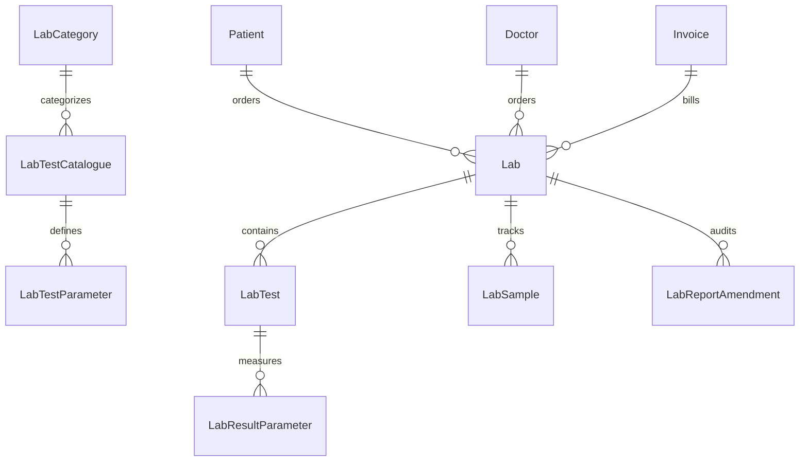
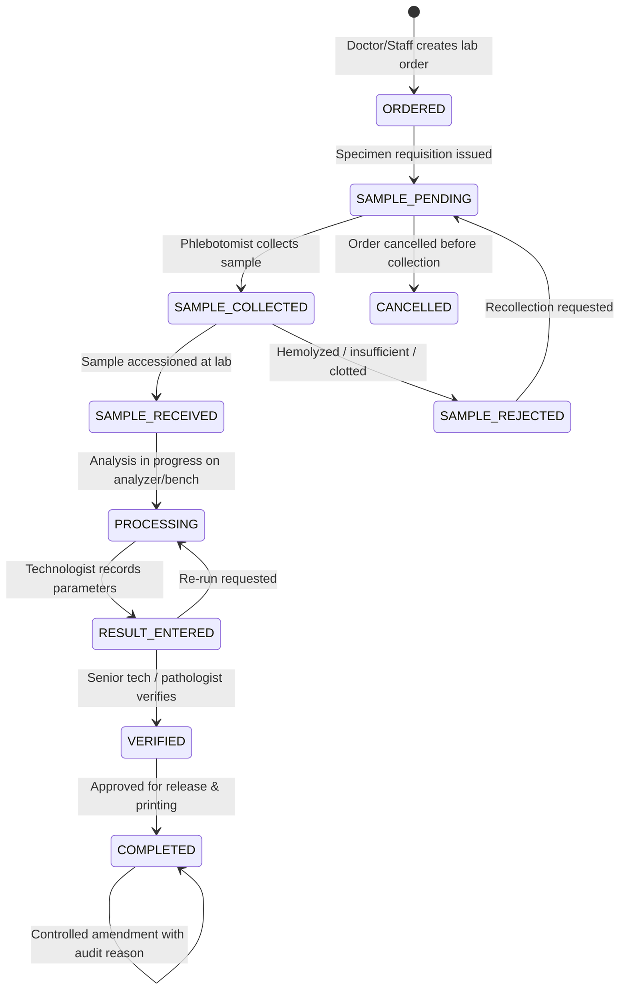

# Laboratory & Diagnostic Management System (LIS) — Migration Mapping

**Project**: Medora 2.0  
**Phase**: Phase 14  
**Date**: 2026-10-31  
**Author**: Medora Engineering  

---

## 1. Executive Summary

This document specifies the migration and modernization of the legacy ICTHospital laboratory module into Medora 2.0's Laboratory Information System (LIS).

In the legacy Laravel system:
- `lab_category` represented the test catalogue (storing test name, description, and reference range).
- `lab` represented the patient request/order (carrying legacy denormalized strings for patient info, tests, and packed reports).
- `lab_test` represented the individual line items on a request, capturing reference range snapshots and individual test results.
- Status transitions were derived: `requested` -> `partial` -> `reported`.

Medora 2.0 modernizes this into a full-scale, clinical LIS with:
1. Structured test hierarchy (Categories, Tests, and multi-line Test Parameters with age/gender reference ranges and measurement units).
2. End-to-end Specimen & Sample Tracking (`LabSample` with unique barcodes, collection timestamps, and sample rejection triage).
3. Explicit 8-stage clinical status lifecycle with transition guards.
4. Separation of duties for Result Entry vs. Clinical Verification/Approval.
5. Immutability of approved clinical reports with structured, audited amendment logs (`LabReportAmendment`).
6. Seamless integration with `InvoiceModule` for billing without financial duplication.
7. Granular RBAC permissions for Laboratorists, Doctors, and Administrators.

---

## 2. Legacy Table Schema & Medora 2.0 Mapping

### 2.1 Table: `lab_category` (Legacy Test Catalogue)

| Legacy Column | Type | Medora 2.0 Entity / Field | Migration & Mapping Strategy |
| :--- | :--- | :--- | :--- |
| `id` | `increments` | `LabCategory.id` / `LabTestCatalogue.id` | Auto-incrementing primary key |
| `category` | `varchar(100)` | `name` | Test or Category Name |
| `description` | `varchar(100)` | `description` | Clinical test description |
| `reference_value`| `varchar(1000)`| `reference_range` | Baseline normal reference range string |
| `procedure_id` | `varchar(100)` | `procedure_code` / `cpt_code` | Optional procedure reference code |
| *New* | - | `price` | Official test service charge |
| *New* | - | `sample_type` | Specimen type (Blood, Serum, Urine, etc.) |
| *New* | - | `turnaround_hours` | Estimated turnaround time |
| *New* | - | `is_active` | Soft deactivation flag |

### 2.2 Table: `lab` (Legacy Lab Request / Order)

| Legacy Column | Type | Medora 2.0 Model | Migration & Mapping Strategy |
| :--- | :--- | :--- | :--- |
| `id` | `increments` | `Lab.id` / `LabOrder.id` | Primary key |
| `patient` | `varchar(100)` | `patient_id` (`BigInt`) | Foreign key to `patient.id` |
| `doctor` | `varchar(100)` | `doctor_id` (`BigInt`) | Nullable foreign key to `doctor.id` |
| `date` | `varchar(100)` | `order_date` (`Date`) | Order date |
| `category` | `varchar(255)` | `category_ids` | Legacy comma-delimited test ID list (backward compat) |
| `category_name`| `varchar(1000)`| `category_name` | Denormalized human-readable test names |
| `report` | `varchar(10000)`| `report_summary` | Legacy aggregated text report |
| `status` | `varchar(100)` | `status` | Modernized enum/string lifecycle |
| `user` | `varchar(100)` | `created_by` | User ID of ordering staff/physician |
| `patient_name` | `varchar(100)` | `patient_name` | Denormalized for legacy report exports |
| `patient_phone`| `varchar(100)` | `patient_phone` | Denormalized for legacy report exports |
| `patient_address`| `varchar(100)`| `patient_address` | Denormalized for legacy report exports |
| `doctor_name` | `varchar(100)` | `doctor_name` | Attending physician name snapshot |
| `invoice_id` | `varchar(100)` | `invoice_id` | Foreign key to `invoice.id` |
| `report_date` | `varchar(100)` | `completed_at` | Timestamp of final verification |

### 2.3 Table: `lab_test` (Ordered Test Line Items)

| Legacy Column | Type | Medora 2.0 Model | Migration & Mapping Strategy |
| :--- | :--- | :--- | :--- |
| `id` | `increments` | `LabTest.id` / `LabOrderItem.id` | Line item primary key |
| `lab_id` | `unsignedInt` | `lab_id` (`BigInt`) | Foreign key to parent `lab.id` |
| `lab_category_id`| `unsignedInt`| `lab_category_id` (`BigInt`) | Foreign key to catalogue test |
| `name` | `varchar(200)` | `name` | Name snapshot at time of order |
| `reference_value`| `varchar(1000)`| `reference_value` | Reference range snapshot at order time |
| `result` | `varchar(1000)`| `result` | Reported clinical result value |
| `status` | `varchar(40)` | `status` | Line item status (`requested`, `reported`, etc.) |
| `reported_at` | `varchar(100)` | `reported_at` (`DateTime`) | Timestamp when result was recorded |

---

## 3. Modernized Relational Architecture

To satisfy all Phase 14 clinical and operational requirements while maintaining 100% backward compatibility with existing legacy tables, Medora 2.0 establishes the following models:

1. **`lab_category`** (`LabCategory`): Test specialty categories (e.g., Hematology, Biochemistry, Microbiology, Serology, Histopathology).
2. **`lab_test_catalogue`** (`LabTestCatalogue`): Formulary of tests offered by the laboratory, including sample requirements, pricing, and normal turnaround.
3. **`lab_test_parameter`** (`LabTestParameter`): Granular components of a test panel (e.g. for CBC: Hemoglobin, WBC, Platelets; for Lipid Profile: Total Cholesterol, HDL, LDL, Triglycerides) with standard units, reference ranges, and display sequences.
4. **`lab`** (`Lab`): Outpatient/Inpatient laboratory requisition order linked to `patient`, `doctor`, `consultation`, `appointment`, and `invoice`.
5. **`lab_test`** (`LabTest`): Relational order line item carrying immutable price snapshots, test name snapshots, and parent order references.
6. **`lab_sample`** (`LabSample`): Physical specimen tracking record with unique sample barcode/ID, collection time, collector ID, receiving time, status (`PENDING`, `COLLECTED`, `RECEIVED`, `REJECTED`), and rejection reason.
7. **`lab_result_parameter`** (`LabResultParameter`): Discrete result values per parameter with snapshot of unit and reference range, abnormal flag (`NORMAL`, `HIGH`, `LOW`, `CRITICAL`), and technologist remarks.
8. **`lab_report_amendment`** (`LabReportAmendment`): Audit log for changes made to clinically approved reports, recording previous values, amended values, requesting pathologist, reason, and timestamp.

---

## 4. Laboratory Lifecycle & Status State Machine

### Transition Guards:
1. **Empty Order Rejection**: An order must contain at least 1 test from the catalogue (`400 Bad Request`).
2. **Sample Rejection**: Rejected samples require an explicit clinical reason (`REJECTION_REASONS`: Hemolyzed, Clotted, Insufficient Quantity, Wrong Container, Mislabeled).
3. **Premature Result Entry**: Results cannot be recorded for samples in `PENDING` or `REJECTED` states.
4. **Approval Immutability**: Once an order reaches `COMPLETED`, parameter values cannot be silently modified. Updates must use `POST /api/v1/lab/orders/:id/amend` with mandatory clinical rationale.
5. **Separation of Duties**: When configured by hospital policy, the user who enters results cannot be the sole approver if another verifier is required.

---

## 5. Billing & InvoiceModule Integration

1. **Price Snapshot**: When tests are ordered, the catalogue price is locked into the order item (`price_snapshot`). Future changes to test fees never alter existing bills.
2. **Unified Invoice Contract**:
   - Lab orders may be billed on-the-fly or linked to an existing consultation invoice.
   - Creating an invoiced lab order generates an `InvoiceItem` under category `'LABORATORY'` or writes a `Payment` transaction.
   - Unpaid or partially paid orders are visible in the LIS workbench with transparent billing badges (`UNPAID`, `PAID`, `EXEMPT`).

---

## 6. Permissions & RBAC Architecture

| Permission Name | String Identifier | Permitted Roles | Clinical Function |
| :--- | :--- | :--- | :--- |
| `LAB_TEST_VIEW` | `lab_test_view` | Admin, Doctor, Laboratorist, Nurse | View test orders and catalogue |
| `LAB_ORDER` | `lab_order` | Admin, Doctor, Laboratorist | Order laboratory tests for patients |
| `LAB_SAMPLE_COLLECT` | `lab_sample_collect` | Admin, Laboratorist, Nurse | Collect and accession laboratory specimens |
| `LAB_PROCESS` | `lab_process` | Admin, Laboratorist | Begin specimen testing/benchwork |
| `LAB_RESULT_ENTER` | `lab_result_enter` | Admin, Laboratorist | Enter and draft test parameter results |
| `LAB_RESULT_VERIFY` | `lab_result_verify` | Admin, Laboratorist | Review and verify entered results |
| `LAB_REPORT_APPROVE`| `lab_report_approve`| Admin, Laboratorist | Authorize and finalize formal clinical reports |
| `LAB_REPORT_AMEND` | `lab_report_amend` | Admin, Laboratorist | Perform controlled clinical amendments |
| `LAB_MANAGE_CATALOGUE`| `lab_manage_catalogue`| Admin, Laboratorist | Manage tests, categories, and parameters |
| `LAB_REPORTS` | `lab_reports` | Admin, Laboratorist | Access turnaround and audit analytics |
