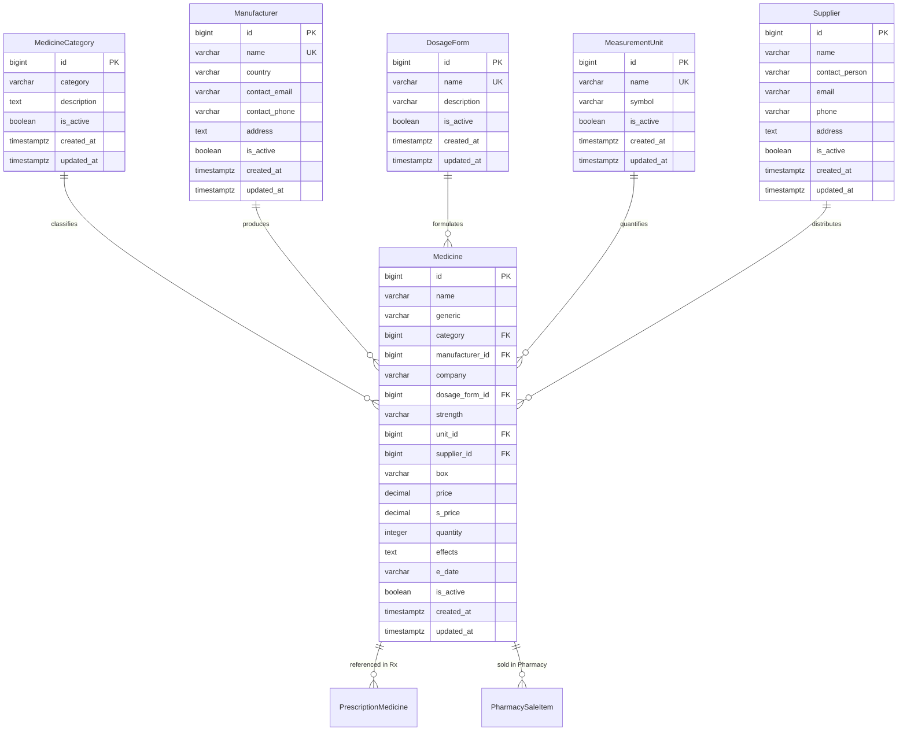

# Medora 2.0 — Medicine Catalogue Mapping & Schema Specification

**Phase**: 12 — Medicine & Pharmacy Catalogue Migration  
**Date**: 2026-10-31  
**Target Database**: Supabase PostgreSQL  
**Target ORM**: Prisma 7  

---

## 1. Executive Summary

This document establishes the audit, field-by-field mapping, type conversions, business rules, and normalized relational design for migrating the legacy hospital medicine catalogue into Medora 2.0.

In the legacy Laravel/SQLite application, medicine catalogue records were managed by `MedicineController.php` against the `medicine` and `medicine_category` tables. Prescriptions (`PrescriptionModule`) and outpatient sales (`PharmacyModule`) both depend directly on this master catalogue.

Phase 12 modernizes the medicine catalogue into a normalized hospital formulary supporting brand names, generics, categories, manufacturers, dosage forms, strengths, units of measurement, suppliers, and active/inactive status, while preserving full backward compatibility for existing prescription history and autocomplete APIs. Complete stock batch tracking, purchase invoices, and dispensing are reserved for Phase 13.

---

## 2. Legacy Field Audit & Analysis

Based on authentic inspection of `legacy/app/Models/Medicine.php`, `legacy/app/Http/Controllers/MedicineController.php`, `legacy/resources/views/app/medicines/form.blade.php`, `legacy/resources/views/app/medicines/index.blade.php`, and `legacy/database/database.sqlite`:

| Legacy Field | SQLite PRAGMA Type | Laravel Validation Rules | Actual Business Usage & Semantics | Target Field in Medora 2.0 | Target Type | Conversion / Default Rules |
| :--- | :--- | :--- | :--- | :--- | :--- | :--- |
| `id` | `INTEGER` PK | Implicit route parameter | Primary auto-increment identifier | `id` | `BigInt` (`bigint`) | Auto-increment sequence `nextval('medicine_id_seq')`. |
| `name` | `varchar(100)` NOT NULL | `required\|string\|max:100` | Commercial brand name (e.g., *Amoxicillin 500mg*, *Panadol*, *Augmentin*) | `name` | `String` (`VARCHAR(100)`) NOT NULL | Direct trim and mapping. Required for all items. |
| `category` | `varchar(100)` NULL | `nullable\|integer\|exists:medicine_category,id` | Foreign key referencing `medicine_category.id` | `categoryId` (`category`) | `BigInt?` (`bigint`) NULL | Mapped to `MedicineCategory.id`. `ON DELETE SET NULL`. |
| `generic` | `varchar(100)` NULL | `nullable\|string\|max:100` | Active pharmaceutical ingredient (API) / Salt name (e.g., *Amoxicillin*, *Paracetamol*) | `generic` | `String?` (`VARCHAR(100)`) NULL | Direct mapping. Indexed for clinical searching. |
| `company` | `varchar(100)` NULL | `nullable\|string\|max:100` | Pharmaceutical manufacturing company (e.g., *GSK*, *Searle*, *Abbott*) | `company` & `manufacturerId` | `String?` & `BigInt?` | Retains raw string in `company` for legacy compatibility, plus optional normalized `Manufacturer` reference. |
| `box` | `varchar(100)` NULL | `nullable\|string\|max:100` | Pack size or packaging description (e.g., *10x10 Tablets*, *1 Bottle 120ml*). Combined with `name` for duplicate detection. | `box` | `String?` (`VARCHAR(100)`) NULL | Converted from mistaken `numeric` in baseline to `VARCHAR(100)` to preserve text packaging format. |
| `price` | `varchar(100)` NULL | `nullable\|numeric\|min:0` | Cost / purchase price paid by hospital (what it cost) | `price` | `Decimal?` (`DECIMAL(10,2)`) | Converted from string to `Decimal(10,2)`, defaults to `0.00`. |
| `s_price` | `varchar(100)` NULL | `nullable\|numeric\|min:0` | Retail sale price charged to patients (what it sells for) | `sPrice` (`s_price`) | `Decimal?` (`DECIMAL(10,2)`) | Converted to `Decimal(10,2)`. Optional if not sold directly. |
| `quantity` | `INTEGER` NOT NULL | `nullable\|integer\|min:0` | Legacy on-hand stock count (default 0) | `quantity` | `Int` (`integer`) NOT NULL | Preserved with `@default(0)` for immediate catalogue visibility before Phase 13 full batch inventory. |
| `effects` | `varchar(100)` NULL | `nullable\|string\|max:100` | Clinical notes, indications, side effects, or precautions | `effects` | `String?` (`TEXT`) | Stored as text to accommodate rich clinical advisories. |
| `e_date` | `varchar(70)` NULL | `nullable\|date` | Legacy product expiry date (YYYY-MM-DD) | `expiryDate` (`e_date`) | `String?` (`VARCHAR(50)`) | Preserved as string/date format for catalogue items; Phase 13 introduces per-batch expiry dates. |
| `add_date` | `varchar(100)` NULL | Auto-assigned `now()->toDateString()` | Date added to hospital catalogue | `createdAt` (`created_at`) | `DateTime` (`TIMESTAMPTZ`) | Superseded by automatic audit timestamp `createdAt DateTime @default(now())`. |

---

## 3. Normalized Relational Design

To support modern clinical workflows without over-engineering, Medora 2.0 establishes four normalized supporting entities linked to `Medicine`:



### Rationale for Supporting Entities:
1. **`MedicineCategory`**: Already present in legacy (`Tablets`, `Syrups`, `Injections`, `Antibiotics`). Retained and enhanced with active status and timestamps.
2. **`Manufacturer`**: Prevents typo-ridden company names across hundreds of stock entries while allowing direct manufacturer lookup.
3. **`DosageForm`**: Standardizes administration routes (`Tablet`, `Capsule`, `Syrup`, `Injection`, `Suspension`, `Ointment`, `Eye Drops`, `Inhaler`, `IV Infusion`).
4. **`MeasurementUnit`**: Standardizes metric dosage units (`mg`, `ml`, `g`, `mcg`, `IU`, `puffs`, `drops`).
5. **`Supplier`**: Prepares for Phase 13 purchase orders, supplier invoices, and vendor batch delivery logs.

---

## 4. Business Rules & Integrity Constraints

### 4.1 Duplicate Prevention
- Legacy Rule: In `MedicineController.php`, a medicine clashes if another record has identical `name` AND identical `box` (pack/strength).
- Medora 2.0 Enforcement:
  Before insertion or update, the system checks whether another active medicine exists with the same normalized name (`TRIM(LOWER(name))`) AND either the same pack size (`box`) or the same strength + dosage form. If a clash occurs, a `409 Conflict` (or `422 Unprocessable Entity`) is returned with:
  `"That medicine is already in the catalogue with the same pack or strength."`

### 4.2 Deletion Guards & Historical Immutability
- Prescribed Medicines: If a medicine is linked to any `PrescriptionMedicine` row, hard deletion is strictly forbidden:
  `400 Bad Request: "<name> has been prescribed in patient records and cannot be deleted from the catalogue. Deactivate it instead."`
- Pharmacy Sales: If a medicine has historical pharmacy sales in `PharmacySaleItem`, hard deletion is rejected.
- Soft Deactivation: Setting `isActive = false` hides the medication from new prescribing searches without breaking historical chart rendering.
- Category Deletion: A category cannot be deleted if active medicines are assigned to it.

### 4.3 Prescription Autocomplete & Historical Snapshots
- `PrescriptionModule` queries:
  `GET /api/v1/prescriptions/medicines/search?q=...`
  Filters only active medicines (`isActive: true`).
- Snapshot Immutability: When a prescription item is saved, `name` is copied directly into `prescription_medicine.name`. Subsequent changes to the catalogue name do not alter past clinical encounter records.
- Off-Catalogue Prescribing: When a physician prescribes a custom compound or unlisted medication, `medicineId` is stored as `null` while `name` stores the free-text description.

---

## 5. Migration Strategy

1. **Alter `medicine.box`**:
   The baseline migration defined `"box" DECIMAL(10,2)`. The live table currently contains 0 rows. Migration `phase_12_medicine_catalogue` safely alters `"box"` to `VARCHAR(100)`:
   ```sql
   ALTER TABLE "medicine" ALTER COLUMN "box" TYPE VARCHAR(100) USING "box"::VARCHAR(100);
   ```
2. **Make `medicine.price` Nullable / Default 0.00**:
   ```sql
   ALTER TABLE "medicine" ALTER COLUMN "price" DROP NOT NULL;
   ALTER TABLE "medicine" ALTER COLUMN "price" SET DEFAULT 0.00;
   ```
3. **Add Supporting Tables & Foreign Keys**:
   Create `manufacturer`, `dosage_form`, `measurement_unit`, and `supplier` tables with appropriate indexes and foreign keys (`ON DELETE SET NULL`).
4. **Add Active Status Column**:
   ```sql
   ALTER TABLE "medicine" ADD COLUMN IF NOT EXISTS "is_active" BOOLEAN NOT NULL DEFAULT true;
   ALTER TABLE "medicine_category" ADD COLUMN IF NOT EXISTS "is_active" BOOLEAN NOT NULL DEFAULT true;
   ```
5. **Add Search Indexes**:
   Add composite indexes on `medicine(name)`, `medicine(generic)`, and `medicine(is_active)` to guarantee sub-millisecond autocomplete performance.
