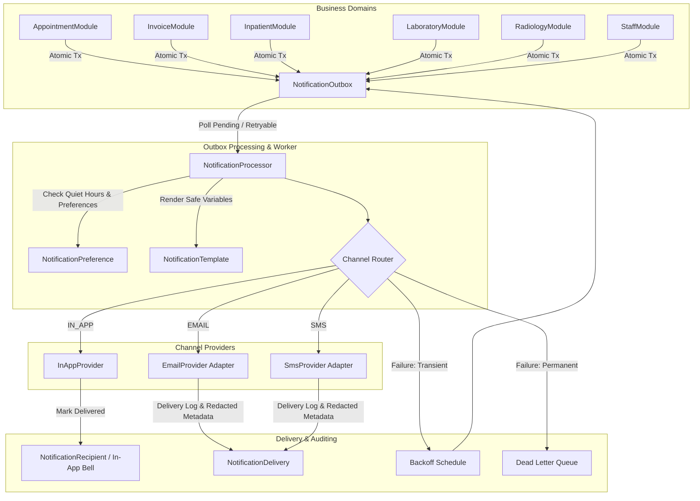
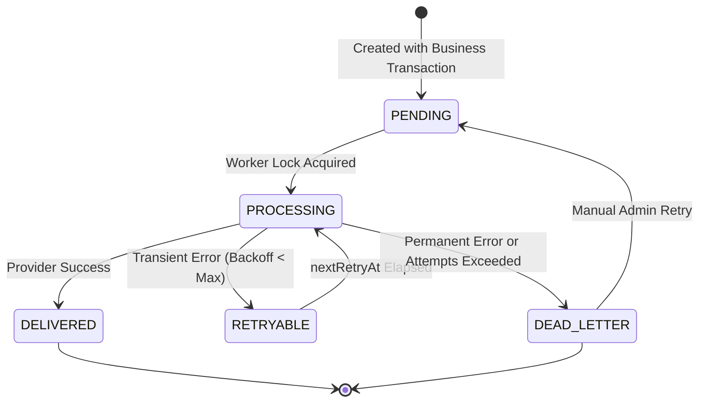

# Notification & Messaging Architecture
## Medora 2.0 — Phase 22 Specification

### 1. Executive Summary & Legacy Modernization
In legacy ICTHospital:
- Telecom and SMS operations were coupled directly to ICTCore (`ICTCoreController.php`, `SmsController.php`, `SMSLog.php`).
- An insecure unauthenticated cron route (`GET /cronjob/payment-reminder`) looped through database records and pushed unredacted patient financial details across arbitrary networks without authorization or audit trails.
- There was no in-app notification center, no user preferences, no delivery status state machine, and no failure recovery mechanism. If a network call failed, patient notifications were either lost or hung PHP processes.

Phase 22 introduces a resilient, secure, branch-aware notification and messaging platform:
1. **Durable Transactional Outbox Pattern**:
   - Notifications triggered by business events (admissions, appointments, payments, lab releases) are persisted atomically within the same database transaction.
   - If an application node crashes immediately after committing a business operation, the notification event is safely stored in the `NotificationOutbox` and processed upon restart.
2. **Provider Abstraction Layer**:
   - Clean provider interfaces for **In-App**, **Email**, and **SMS**.
   - Safe Development/Mock adapters (`DevMockEmailProvider`, `DevMockSmsProvider`, `InAppNotificationProvider`) ensuring zero real emails or SMS are sent in test/development environments.
   - Ready for pluggable production adapters (SMTP, SendGrid, Telenor, Twilio) via encrypted provider configurations.
3. **Controlled Retry & Dead-Letter Handling**:
   - Bounded retries (default max 5 attempts) with exponential backoff: $\text{delay} = 2^{\text{attempt}} \times 30\text{ seconds}$ (capped at 1 hour).
   - Error classification: Transient errors (timeouts, rate limits) schedule retries; permanent errors (invalid phone/email, malformed recipient) transition immediately to `DEAD_LETTER` to prevent infinite loops.
   - Orphaned job recovery: Workers identify and reclaim jobs stuck in `PROCESSING` status due to unexpected node termination.
4. **Zero-Trust Branch Isolation & Recipient Privacy**:
   - In-app notifications are strictly scoped to the receiving `userId` or `patientId`. Users can never view another recipient's notifications.
   - Administrative notification monitors enforce branch-level boundaries (`BranchAccessGuard`).

---

### 2. System Architecture & Component Diagram



---

### 3. Database Model & State Lifecycle



#### Status Enum Semantics:
- `PENDING`: Outbox event created; awaiting worker pickup.
- `PROCESSING`: Job currently locked and in flight with provider adapter.
- `DELIVERED`: Confirmed delivered (in-app) or accepted by external telecom/email provider.
- `RETRYABLE`: Experienced transient network/provider error; scheduled for next exponential backoff attempt.
- `DEAD_LETTER`: Terminal failure (recipient invalid, authentication rejected, or max retry attempts reached).
- `CANCELLED`: Superseded or revoked by business action (e.g. appointment cancelled before reminder sent).

---

### 4. Concurrency Safety & Outbox Worker Polling
To guarantee that multiple backend instances or clustered processes do not dispatch duplicate messages:
1. **Advisory Transaction Lock / Skip Locked**:
   ```sql
   SELECT id FROM notification_outbox
   WHERE status IN ('PENDING', 'RETRYABLE')
     AND (scheduled_at IS NULL OR scheduled_at <= NOW())
     AND (next_retry_at IS NULL OR next_retry_at <= NOW())
   ORDER BY scheduled_at ASC
   LIMIT 50
   FOR UPDATE SKIP LOCKED;
   ```
2. **Crash Recovery & Heartbeat**:
   Jobs remaining in `PROCESSING` status for longer than 5 minutes (`processing_started_at < NOW() - INTERVAL '5 minutes'`) are automatically reset to `RETRYABLE` by the worker watchdog.
3. **Idempotency & Deduplication Key**:
   The unique constraint `deduplication_key` (`VARCHAR(150) UNIQUE`) prevents duplicate outbox entries when a user rapidly retries or resubmits business forms.
