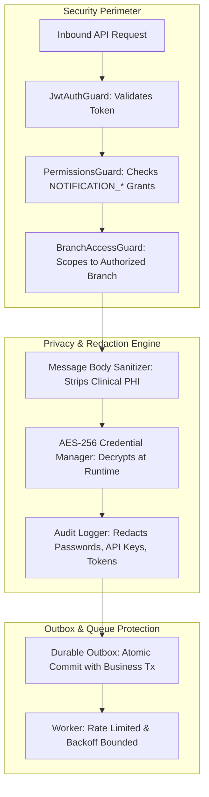

# Notification Security & Privacy Standards
## Medora 2.0 — Phase 22 Specification

### 1. Security Principles & Threat Analysis
Healthcare notifications handle personal identifiers, financial data, and clinical encounter notices. In legacy systems, notifications were vulnerable to:
- Insecure direct object reference (IDOR): Users viewing arbitrary SMS log records.
- Plaintext credentials: SMTP and telecom passwords stored unencrypted in `ictcore_integration` and `settings`.
- Public trigger endpoints: Insecure cron URLs exposed to internet crawlers.
- Sensitive information leakage: Prescriptions and diagnoses in plaintext SMS over telecom networks.

Medora 2.0 enforces a multi-layered security and privacy model:

---

### 2. Mandatory Security Rules

1. **Strict Elimination of Legacy Public Cron Route**:
   - The legacy `/cronjob/payment-reminder` endpoint is permanently banned.
   - Batch payment reminders and scheduled alerts are triggered exclusively via secure CLI commands (`npm run cron:notifications`), internal worker timers, or authenticated administrative endpoints requiring `NOTIFICATION_ADMIN_VIEW` and `NOTIFICATION_QUEUE_MONITOR`.
2. **Zero Plaintext Secrets at Rest**:
   - Any external provider credentials (SMTP passwords, SMS API keys, Twilio auth tokens) must be encrypted at rest using AES-256-GCM or supplied via environment variables (`SMTP_PASSWORD`, `SMS_GATEWAY_API_KEY`).
   - Plaintext credentials must NEVER be returned over any REST endpoint or written to database logs.
3. **Sensitive Clinical Data Minimization (PHI Protection)**:
   - Plaintext SMS and Email messages must NEVER contain:
     - Disease names or diagnostic codes (ICD-10).
     - Drug names, dosages, or prescription instructions.
     - Laboratory numerical results, flags, or pathology interpretations.
     - Radiology findings or impression text.
   - External reminders only state that a document or report is ready, directing the patient to log in to their authenticated portal.
4. **Recipient Isolation & Zero-Trust Access Control**:
   - `GET /api/v1/notifications` retrieves ONLY notifications where `NotificationRecipient.userId == authenticatedUserId`.
   - Patients access only records where `NotificationRecipient.patientId == authenticatedPatientId`.
   - Users cannot mark another recipient's notification as read or query another user's unread counter.
5. **Branch Boundary Enforcement**:
   - Administrative notification views (`GET /api/v1/admin/notifications`) filter strictly by the administrator's authorized branch (`activeBranchId`).
   - Global administrators with `BRANCH_VIEW_ALL` can inspect all branches.
6. **Rate Limiting & Abuse Prevention**:
   - Notification triggering endpoints (e.g. resend receipt, manual retry) are protected by `ThrottlerGuard` (maximum 10 requests per minute per IP/user).
   - Prevents telecom SMS exhaustion attacks and flooding patient phones.
7. **Safe Template Escaping & Anti-Injection**:
   - Dynamic template variables (`{{patientName}}`, `{{appointmentTime}}`) are sanitized and escaped to prevent stored XSS and HTML injection.
