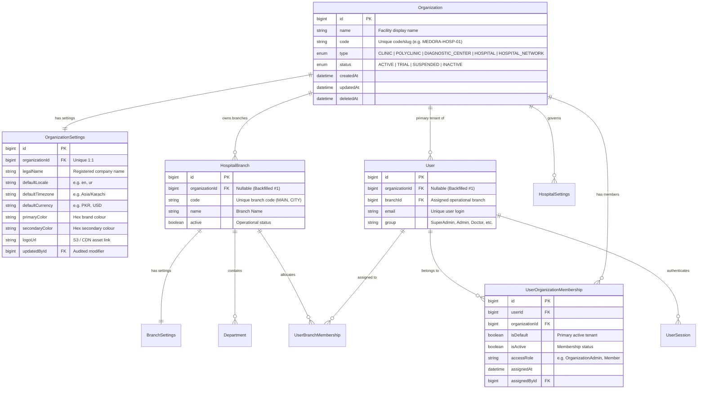

# Medora 2.0 — Phase 10.1: Organization & Tenant Architecture

## 1. Executive Summary

Medora 2.0 has evolved from a single-hospital, multi-branch system into a multi-tenant healthcare platform capable of hosting independent healthcare organizations—ranging from solo practitioner clinics and polyclinics to diagnostic imaging centres and multi-facility hospital networks.

Phase 10.1 establishes the foundational **Organization (Tenant)** data model, relational architecture, and tenant context propagation. It achieves this while strictly maintaining backward compatibility with the existing single-hospital operational workflows, preserving all legacy database records, and laying the groundwork for Phase 10.2 (Feature Entitlements) and Phase 10.3 (Clinic Edition UI).

---

## 2. Multi-Tenant Architectural Hierarchy

The Medora 2.0 multi-tenant model establishes a clean 3-tier hierarchy:

```
Platform (Medora 2.0 Core)
  └── Organization (Tenant: Clinic / Polyclinic / Hospital / Hospital Network)
        ├── OrganizationSettings (Branding, Legal, Timezone, Currency)
        ├── UserOrganizationMembership (Access Role, Default Tenant)
        └── HospitalBranch (Operational Facility / Physical Location)
              ├── BranchSettings (Branch-specific Operational Overrides)
              ├── Department (Clinical & Administrative Departments)
              │     ├── Wards & Beds (Inpatient Capacity)
              │     └── Consultations & Doctors (OPD Workflows)
              └── Transactions (Invoices, Payments, Labs, Radiology, Prescriptions)
```

---

## 3. Entity-Relationship Diagram (ERD)

The following Mermaid diagram illustrates the relationships between the tenant models, branches, users, and core configuration:



---

## 4. Model Specifications & Enums

### 4.1. `OrganizationType` Enum
Defines the architectural archetype and clinical scope of the healthcare tenant:
- `CLINIC`: Solo practitioner or single-specialty clinic (lightweight OPD, appointments, prescriptions, cash billing).
- `POLYCLINIC`: Multi-specialty outpatient medical centre with multiple doctors, shared reception, and minor diagnostics.
- `DIAGNOSTIC_CENTER`: Standalone laboratory or medical imaging/radiology centre.
- `HOSPITAL`: Full-service inpatient and outpatient hospital with emergency, operating theatre, wards, and complex pharmacy.
- `HOSPITAL_NETWORK`: Multi-hospital healthcare system or regional hospital group with central governance.

### 4.2. `OrganizationStatus` Enum
Governs tenant lifecycle and platform access:
- `ACTIVE`: Fully operational tenant in good standing.
- `TRIAL`: Evaluation period with unrestricted evaluation functionality.
- `SUSPENDED`: Read-only or blocked access due to billing or administrative hold.
- `INACTIVE`: Decommissioned or archived organization.

### 4.3. `Organization` Model
- `id`: Auto-incrementing BigInt primary key.
- `name`: Display name of the healthcare organization.
- `code`: Unique, indexed alphanumeric slug (e.g. `MEDORA-HOSP-01`, `ALSHIFA-CLN-01`).
- `type`: Enum `OrganizationType` (default: `HOSPITAL`).
- `status`: Enum `OrganizationStatus` (default: `ACTIVE`).
- `createdAt`, `updatedAt`, `deletedAt`: Standard temporal and soft-deletion tracking.

### 4.4. `OrganizationSettings` Model
Houses tenant-level preferences, localization, and branding:
- `organizationId`: Unique foreign key to `organizations(id)`.
- `legalName`, `registrationNumber`, `taxNumber`: Legal compliance attributes.
- `email`, `phone`, `website`, `address`: Contact directory.
- `defaultLocale`, `defaultTimezone`, `defaultCurrency`: Internationalization defaults.
- `dateFormat`, `timeFormat`: UI timestamp display formats.
- `logoUrl`, `faviconUrl`, `primaryColor`, `secondaryColor`: White-label branding parameters.
- `updatedById`: User ID tracking the last administrative modifier.

### 4.5. `UserOrganizationMembership` Model
Provides many-to-many tenant membership flexibility, allowing doctors and medical specialists to hold credentials across multiple clinics or hospitals:
- `userId`: Foreign key to `users(id)`.
- `organizationId`: Foreign key to `organizations(id)`.
- `isDefault`: Boolean flag indicating the user's primary tenant.
- `isActive`: Boolean flag for immediate revocation without deleting historical attribution.
- `accessRole`: Tenant-level authority moniker (e.g., `OrganizationAdmin`, `Member`, `Consultant`).
- `assignedAt`, `assignedById`, `revokedAt`, `revokedById`: Complete governance audit trail.

---

## 5. Security Context & Authentication Integration

The authentication module was enhanced to propagate tenant identity through every layer of the application:

1. **`AuthUser` Interface**:
   ```typescript
   export interface AuthUser {
     id: string;
     email: string;
     name: string;
     group: HospitalRole;
     permissions: string[];
     branchId?: bigint | null;
     staffId?: bigint | null;
     organizationId?: bigint | null; // Tenant Identity
   }
   ```

2. **JWT Payload**:
   The JWT access token payload includes `organizationId: string | null`, allowing downstream guards, interceptors, and services to extract tenant scope without performing redundant database roundtrips.

3. **`UserProfileDto`**:
   The `/api/v1/auth/login`, `/api/v1/auth/refresh`, and `/api/v1/auth/me` endpoints return `organizationId` directly in the user profile payload, enabling frontend routing and workspace theming.

4. **Multi-Tenant Boundary Protection**:
   - `SuperAdmin` users retain cross-tenant visibility for platform governance, licensing, and tenant provisioning.
   - `HospitalAdmin`, `Doctor`, and other operational personas operate strictly within their active `organizationId`.
   - The `@SkipBranchCheck()` decorator was applied to `OrganizationController` so that tenant management endpoints can operate above the facility branch boundary.

---

## 6. Organization Management API

The `OrganizationModule` exposes a comprehensive RESTful API under `/api/v1/organizations`:

| Method | Endpoint | Authorized Roles | Description |
|---|---|---|---|
| `GET` | `/api/v1/organizations` | `SuperAdmin`, `Admin` | List all healthcare organizations with optional type and status filtering |
| `GET` | `/api/v1/organizations/my-organizations` | Authenticated | List all organizations the current authenticated user belongs to |
| `GET` | `/api/v1/organizations/:id` | `SuperAdmin`, `Admin`, `Doctor` | Retrieve full organization details, settings summary, and branch list |
| `POST` | `/api/v1/organizations` | `SuperAdmin` | Provision a new organization with auto-generated default settings and creator membership |
| `PUT` | `/api/v1/organizations/:id` | `SuperAdmin`, `Admin` | Update organization name, facility type, or operational status |
| `GET` | `/api/v1/organizations/:id/settings` | `SuperAdmin`, `Admin` | Retrieve tenant settings, branding colours, and localization preferences |
| `PUT` | `/api/v1/organizations/:id/settings` | `SuperAdmin`, `Admin` | Update legal, currency, timezone, and branding properties |
| `GET` | `/api/v1/organizations/:id/branches` | `SuperAdmin`, `Admin`, `Doctor` | List all hospital branches belonging to the organization |
| `GET` | `/api/v1/organizations/:id/members` | `SuperAdmin`, `Admin` | List all active user memberships belonging to the organization |

---

## 7. Extensibility Roadmap

- **Phase 10.2 (Feature Entitlements & Subscription Tiers)**:
  An `OrganizationSubscription` or `FeatureEntitlement` matrix will be introduced to control feature availability (e.g. `IPD_ADMISSION`, `PHARMACY_FEFO`, `RADIOLOGY_PACS`, `ACCOUNTING_LEDGER`) based on whether the tenant is licensed for **Medora Clinic**, **Medora Professional**, or **Medora Hospital**.
- **Phase 10.3 (Clinic Edition UI & Simplified Workspaces)**:
  Dedicated clinic navigation and lightweight workflows tailored for single-doctor and small polyclinic environments, eliminating unused hospital-grade menus (such as ward bed management or morgue/OT scheduling) while retaining the unified backend domain logic.

