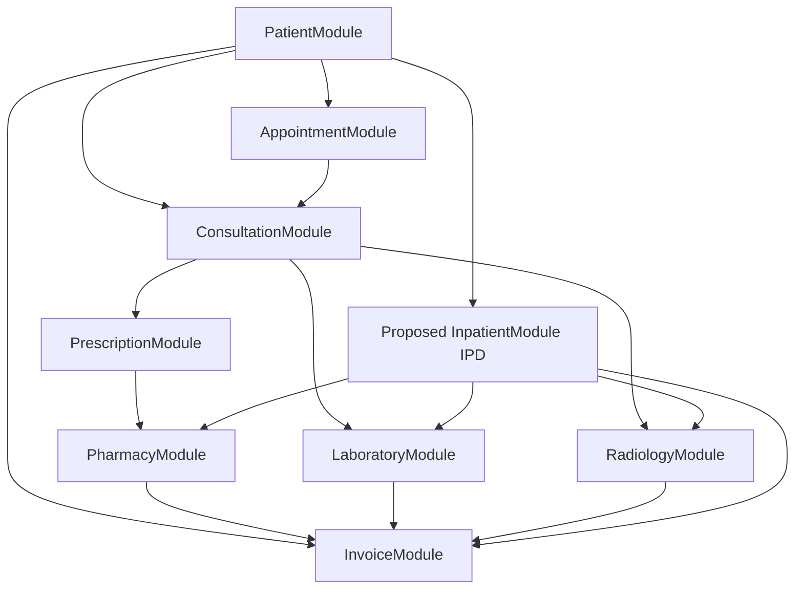

# Phase 16 — Complete Legacy Gap Analysis & Remaining Module Discovery
## Medora 2.0 | Migration Planning and Architecture Audit

- **Date**: 2026-11-02
- **Author**: Medora 2.0 Migration Team
- **Status**: **AUDIT COMPLETE**
- **Target Repository**: `F:\yash\projects\full system\ICTHospital`
- **Branch**: `feat/medora-2.0-migration`

---

## 1. Executive Summary

This document presents a comprehensive, evidence-based audit of the legacy **ICTHospital** codebase (`legacy/`) against the modernized **Medora 2.0** target architecture (NestJS 11 + Supabase PostgreSQL + React 19).

Following the successful migration of 11 clinical, administrative, and diagnostic domains through Phase 15 (Radiology Information System), Phase 16 executes a systematic cataloging of all remaining routes, controllers, models, migrations, views, permissions, background jobs, and legacy artifacts.

### Key Audit Metrics
- **Total Legacy Route Declarations Audited**: 251 routes (250 Web + 1 API).
- **Total Legacy Eloquent Models Audited**: 96 models in `legacy/app/Models/`.
- **Total Legacy Controllers Audited**: 43 controllers + 4 auth controllers.
- **Total Legacy Database Tables**: 104 tables in legacy MySQL/MariaDB/SQLite.
- **Obsolete / School Fork Tables Discovered**: 33 tables and 12 models identified as dead school-management remnants (`SchoolTableRemover.php`).
- **Active Hospital Domains Evaluated**: 17 domains.
  - **Fully Migrated**: 11 domains (Authentication, Patient, Department, Doctor, Appointment, Consultation, Invoicing/Billing, Prescription, Medicine Catalogue, Pharmacy Inventory, Laboratory, Radiology).
  - **Partially Migrated**: 4 domains (Cashier/Shift Closing, Non-Medical Staff Registers, Hospital Settings & Branches, Service Packages).
  - **Not Migrated**: 3 core operational domains (Inpatient & Bed Management / IPD, General Accounting & Expenses, Asynchronous Communications Gateway).
  - **Requires Business-Owner Decision**: 2 unmapped legacy skeletons (Blood Bank & Donors, Operation Theatre / Surgical Suite).
  - **Obsolete / Unused**: 1 domain (ICTSchool fork artifacts).

---

## 2. Complete Legacy Module Inventory & Status Classification

Every module discovered in `legacy/` has been classified according to its migration status, underlying database tables, legacy source references, business rules, and target architecture alignment:

| Domain / Module | Legacy Controllers | Legacy Models | Legacy Tables | Routes Count | Legacy Permissions | Medora 2.0 Status | Target Module / Phase |
| :--- | :--- | :--- | :--- | :---: | :--- | :---: | :--- |
| **1. Authentication & Session** | `UsersController`, `Auth\*` | `User`, `Users`, `VerificationCode` | `users`, `user_sessions` | 15 | `admin`, `super_admin` | **Fully Migrated** | `AuthModule` (Phase 4 / 10.5) |
| **2. Patient Demographics & Records** | `PatientController`, `MedicalHistoryController` | `Patient`, `MedicalHistory`, `PatientMaterial` | `patient`, `medical_history` | 16 | `patient_view`, `patient_add`, `patient_update`, `patient_delete` | **Fully Migrated** | `PatientModule` (Phase 5) |
| **3. Clinical Specialties & Departments** | `DepartmentController` | `Department` | `department` | 5 | `department_view`, `department_add`, `department_update`, `department_delete` | **Fully Migrated** | `DepartmentModule` (Phase 6) |
| **4. Medical Staff & Doctor Register** | `DoctorController` | `Doctor`, `DoctorSlot`, `SlotBlock` | `doctor`, `doctor_slot`, `slot_block` | 7 | `doctor_view`, `doctor_add`, `doctor_update`, `doctor_delete`, `doctor_schedule` | **Fully Migrated** | `DoctorModule` (Phase 7) |
| **5. Outpatient Scheduling & Appointments** | `AppointmentController`, `OpdController` | `Appointment`, `VisitFee` | `appointment`, `visit_fee` | 7 | `appointment_view`, `appointment_add`, `appointment_update`, `appointment_cancel` | **Fully Migrated** | `AppointmentModule` (Phase 8) |
| **6. Clinical Consultations & Encounters** | `ConsultationController` | `Consultation`, `ConsultTemplate` | `consultation`, `consult_template` | 23 | `consultation_view`, `consultation_add` | **Fully Migrated** | `ConsultationModule` (Phase 9) |
| **7. Invoicing, Pricing & Billing** | `InvoiceController`, `PaymentCategoryController`, `PricingController`, `DoctorShareController` | `Payment`, `InvoiceItem`, `InvoicePayment`, `PaymentCategory`, `ServicePrice`, `PatientType`, `DoctorShare`, `SharePolicy`, `ShareRule` | `payment`, `invoice_item`, `invoice_payment`, `payment_category`, `service_price`, `patient_type`, `doctor_share`, `share_policy`, `share_rule` | 42 | `invoice_view`, `payment_add`, `payment_delete`, `service_view`, `service_update`, `doctor_share_view`, `doctor_share_approve` | **Fully Migrated** | `InvoiceModule` (Phase 10) |
| **8. Clinical Prescriptions (e-Rx)** | `PrescriptionController` | `Prescription`, `PrescriptionMedicine` | `prescription`, `prescription_medicine` | 8 | `prescription_view`, `prescription_add`, `prescription_update`, `prescription_delete` | **Fully Migrated** | `PrescriptionModule` (Phase 11) |
| **9. Medicine Master Catalogue** | `MedicineController`, `MedicineCategoryController` | `Medicine`, `MedicineCategory` | `medicine`, `medicine_category`, `manufacturer`, `dosage_form`, `measurement_unit`, `supplier` | 8 | `medicine_view`, `medicine_add`, `medicine_update`, `medicine_delete` | **Fully Migrated** | `MedicineModule` (Phase 12) |
| **10. Pharmacy Inventory & POS Dispensing** | `PharmacyController` | `PharmacyPayment`, `PharmacySaleItem`, `Purchase` | `medicine_batch`, `stock_movement`, `purchase_order`, `goods_receipt`, `pharmacy_dispensation`, `stock_adjustment`, `pharmacy_return` | 5 | `pharmacy_stock_view`, `pharmacy_sale` | **Fully Migrated** | `PharmacyModule` (Phase 13) |
| **11. Laboratory Information System (LIS)** | `LabController`, `LabCategoryController` | `Lab`, `LabCategory`, `LabTest` | `lab_category`, `lab_test_parameter`, `lab`, `lab_sample`, `lab_test`, `lab_result_parameter`, `lab_report_amendment` | 10 | `lab_test_view`, `lab_test_add`, `lab_test_update`, `lab_test_delete` | **Fully Migrated** | `LaboratoryModule` (Phase 14) |
| **12. Radiology Information System (RIS)** | `RadiologyController` | `RadiologyExam`, `RadiologyOrder` | `radiology_category`, `radiology_exam`, `radiology_order`, `radiology_report_amendment` | 10 | `diagnostic_report_view`, `diagnostic_report_add` | **Fully Migrated** | `RadiologyModule` (Phase 15) |
| **13. Inpatient & Bed Management (IPD / Ward)** | `AdmissionController`, `BedController` | `AllotedBed`, `Bed`, `BedCategory` | `admissions` / `alloted_bed`, `bed`, `bed_category` | 14 | `admission_view`, `admission_add`, `admission_discharge`, `bed_view`, `bed_allot`, `bed_release`, `ward_view`, `ward_add`, `ward_update`, `ward_delete` | **Not Migrated** | **Proposed Phase 17: Inpatient (IPD)** |
| **14. Cash Drawer, Shift Close & Day Book** | `CashController` | `ShiftClose` | `shift_close` | 5 | `cash_close`, `cash_close_all_users`, `view_payment_reports` | **Partially Migrated** | **Proposed Phase 18: Cashier & Treasury** |
| **15. Non-Medical Staff Registers** | `StaffController` | `Nurse`, `Accountant`, `Pharmacist`, `Laboratorist`, `Receptionist` | `nurse`, `accountant`, `pharmacist`, `laboratorist`, `receptionist` | 6 | `nurse_view`, `nurse_add`, `nurse_update`, `nurse_delete`, `staff_view`, `staff_add`, `staff_update`, `staff_delete` | **Partially Migrated** | **Proposed Phase 19: Staff Directory** |
| **16. General Accounting & Expenses** | `AccountingController` | `Accounting`, `AccountSector`, `AccountingSetting` | `accounting`, `account_sector`, `accounting_settings` | 31 | `accounting`, `expense_view`, `expense_add`, `expense_update`, `expense_delete` | **Not Migrated** | **Proposed Phase 20: General Accounting** |
| **17. Hospital Settings & Multi-Branch** | `InstituteController`, `BranchController`, `SettingsController` | `Institute`, `HospitalBranch`, `Settings`, `WebsiteSettings` | `institute`, `branches`, `hospital_branch`, `hospital_branch_users`, `settings` | 16 | `branch_view`, `branch_add`, `branch_update`, `branch_delete`, `hospital_information_add` | **Partially Migrated** | **Proposed Phase 21: Settings & Branches** |
| **18. Telephony, SMS & Communications** | `ICTCoreController`, `SmsController`, `TemplateController`, `MessageController`, `CronjobController` | `SMS`, `SMSLog`, `Template`, `Message`, `Ictcore_integration`, `Ictcore_attendance`, `Ictcore_fees`, `Schedule` | `smsFormat`, `sms_settings`, `template`, `messages`, `ictcore_integration`, `ictcore_attendance`, `ictcore_fees` | 19 | `send_sms_voice`, `send_notification`, `view_sms_voice_log_reports` | **Not Migrated** | **Proposed Phase 22: Async Communications (BullMQ)** |
| **19. Clinical Service Packages** | `PackageController` | `ServicePackageItem` | `service_package_item` | 3 | `service_view`, `service_update` | **Partially Migrated** | Integrated in Billing / Catalog |
| **20. Blood Bank & Donor Registry** | *None (orphan)* | `Donor`, `Bankb` | `donor`, `bankb` | 0 | *None* | **Requires Decision** | Blood Bank (Needs Specification) |
| **21. Operation Theatre & Surgical Suite** | *None (orphan)* | `OtPayment` | `ot_payment` | 0 | `operation_theatre_view`, `operation_theatre_schedule` (UI only) | **Requires Decision** | OT Module (Needs Clinical Scope) |
| **22. Inherited School System Remnants** | *None (dead code)* | `GPA`, `Marks`, `Subject`, `Question`, `Diary`, `FeeCol`, `FeeSetup`, `Level` | 33 tables in `SchoolTableRemover::TABLES` | 0 | *None* | **Obsolete / Unused** | Deprecated / Discard |

---

## 3. Detailed Analysis of Unmigrated & Partially Migrated Domains

### Domain 13: Inpatient & Bed Management (IPD / Ward) — NOT MIGRATED
- **Legacy Files**: [`AdmissionController.php`](../legacy/app/Http/Controllers/AdmissionController.php), [`BedController.php`](../legacy/app/Http/Controllers/BedController.php), [`AllotedBed.php`](../legacy/app/Models/AllotedBed.php), [`Bed.php`](../legacy/app/Models/Bed.php), [`BedCategory.php`](../legacy/app/Models/BedCategory.php).
- **Core Business Rules Verified in Source**:
  1. **Strict Single-Occupancy Guard**: A bed holds at most one patient at any given time (`AllotedBed::occupied()->where('bed_id', $bed->id)`). Concurrent attempts lock rows via pessimistic transaction lock (`lockForUpdate()`).
  2. **Single Active Admission Rule**: A patient cannot be admitted to more than one bed simultaneously (`AllotedBed::occupied()->where('patient', $patientId)`).
  3. **Discharge Timestamp Validation**: Discharging stamps leaving timestamp `d_time`, sets status to `discharged`, and frees the bed (`bed.status = 'free'`). Discharging twice is strictly rejected. A patient cannot be discharged before their admission time (`d_time >= a_time`).
  4. **Ward-Scoped Bed Numbering**: Bed numbers are unique within a specific `bed_category` (Ward), but not globally, allowing wards to independently number beds (e.g. Bed 1 in ICU vs Bed 1 in Male General).
  5. **Deletion Guards**: An occupied bed cannot be deleted while a patient is admitted. A ward type (`BedCategory`) cannot be deleted while it contains registered beds.
- **Current Medora 2.0 Gap**:
  - Raw un-indexed models `BedCategory`, `Bed`, `AllotedBed` exist from initial baseline migration `0_init`, but have string timestamps (`a_time VARCHAR(100)`, `d_time VARCHAR(100)`).
  - No NestJS module (`InpatientModule` or `AdmissionModule`), zero DTOs, zero controllers, zero unit/E2E tests, and zero frontend screens exist.
  - Inpatient nurse daily notes, bed transfer workflows, and integration with `InvoiceModule` for auto-calculating bed day-charges are entirely missing.
- **Migration Complexity**: **High** (requires state machine, room-level locking, bed transfer audit trail, and daily rate billing integration).
- **Operational Priority**: **CRITICAL (P1 — Next Phase)**.

---

### Domain 14: Cash Drawer, Shift Close & Day Book — PARTIALLY MIGRATED
- **Legacy Files**: [`CashController.php`](../legacy/app/Http/Controllers/CashController.php), [`ShiftClose.php`](../legacy/app/Models/ShiftClose.php).
- **Core Business Rules Verified in Source**:
  1. **Cash Drawer Balancing**: Tracks all payments collected by a cashier since their last shift close (`where('received_by', $userId)->whereNull('shift_close_id')`).
  2. **Variance Auditing**: Computes breakdown across payment modes (Cash, Bank Transfer, Card, Cheque, Other). Calculates difference between counted physical cash and expected cash: `difference = counted_cash - expected_cash`.
  3. **Atomic Shift Lock**: Links included payment receipts to the new `shift_close_id` within a database transaction, preventing receipt re-counting.
  4. **Supervisor Dual-Signoff**: Supervisors holding `cash_close_all_users` can view and audit any cashier's open drawer; regular cashiers can only view their own.
  5. **Patient Final Settlement**: `/settlement/{patient}` aggregates unbilled balances across pharmacy, lab, radiology, and beds to accept a single lump-sum final settlement payment.
- **Current Medora 2.0 Gap**:
  - `Payment` and `InvoicePayment` exist in `InvoiceModule`, but cashier shift open/close tracking and physical drawer cash variance reporting are not implemented.
- **Migration Complexity**: **Medium**.
- **Operational Priority**: **High (P2)**.

---

### Domain 15: Non-Medical Staff Registers — PARTIALLY MIGRATED
- **Legacy Files**: [`StaffController.php`](../legacy/app/Http/Controllers/StaffController.php), [`StaffLogin.php`](../legacy/app/Support/StaffLogin.php), models `Nurse.php`, `Accountant.php`, `Pharmacist.php`, `Laboratorist.php`, `Receptionist.php`.
- **Core Business Rules Verified in Source**:
  1. Unified metadata-driven controller managing 5 identical tables (`nurse`, `accountant`, `pharmacist`, `laboratorist`, `receptionist`).
  2. Optional staff login linking: automatically creates or links a `users` table record (`ion_user_id`) with the matching role group upon staff profile creation.
  3. Image attachment storage for staff identification badges.
- **Current Medora 2.0 Gap**:
  - `DoctorModule` was migrated in Phase 7. User logins and RBAC exist. However, staff demographic profiles (department, shift assignments, employee numbers, phone, photo) for nurses, receptionists, accountants, and lab techs remain unmigrated.
- **Migration Complexity**: **Low-Medium**.
- **Operational Priority**: **Medium (P3)**.

---

### Domain 16: General Accounting, Expenses & Chart of Accounts — NOT MIGRATED
- **Legacy Files**: [`AccountingController.php`](../legacy/app/Http/Controllers/AccountingController.php), models `Accounting.php`, `AccountSector.php`, `AccountingSetting.php`.
- **Core Business Rules Verified in Source**:
  1. Two-tier chart of accounts: `account_sector` (`Income` vs `Expense`).
  2. Manual ledger entries in `accounting` with date, amount, sector name, and description.
  3. External accounting integration bridge (`accounting_settings` with `api_link`, `company_id`, `username`, `password`).
  4. Monthly and annual P&L summaries with date-range printouts.
- **Current Medora 2.0 Gap**:
  - Zero accounting or expense tracking models/endpoints in NestJS.
- **Migration Complexity**: **Medium**.
- **Operational Priority**: **Medium-Low (P4)**.

---

### Domain 17: Hospital Settings, Multi-Branch & Identity Admin — PARTIALLY MIGRATED
- **Legacy Files**: [`InstituteController.php`](../legacy/app/Http/Controllers/InstituteController.php), [`BranchController.php`](../legacy/app/Http/Controllers/BranchController.php), [`SettingsController.php`](../legacy/app/Http/Controllers/SettingsController.php).
- **Core Business Rules Verified in Source**:
  1. Hospital branding settings: Hospital name, logo, address, phone, emergency hotline, currency symbol, default tax rates.
  2. Branch tenancy: Multi-branch isolation where users are mapped to `hospital_branch_users` and switch branches at runtime.
- **Current Medora 2.0 Gap**:
  - `HospitalBranch` and `Institute` exist in Prisma schema, but branch switching and centralized settings API are not yet built.
- **Migration Complexity**: **Low-Medium**.
- **Operational Priority**: **Medium (P5)**.

---

### Domain 18: Telephony, SMS & Communications — NOT MIGRATED (Architectural Overhaul)
- **Legacy Files**: [`ICTCoreController.php`](../legacy/app/Http/Controllers/ICTCoreController.php), [`SmsController.php`](../legacy/app/Http/Controllers/SmsController.php), [`CronjobController.php`](../legacy/app/Http/Controllers/CronjobController.php), `SMS.php`.
- **Legacy Defects & Security Findings**:
  - **SEC-02**: Public unauthenticated HTTP endpoint `/cronjob/payment-reminder` triggers external telephony calls and SMS.
  - **SEC-05**: SMS and telecom gateway credentials stored in plaintext in MySQL.
  - **SEC-06**: Insecure raw cURL calls and unsanitized XML parsing.
- **Medora 2.0 Architectural Requirements**:
  - Must NOT be ported as synchronous HTTP routes or unauthenticated crons.
  - Must use **Redis + BullMQ** workers running in background queue processors with rate limiting, exponential backoff, dead-letter queues, and encrypted credentials.
- **Migration Complexity**: **High** (infrastructure + worker queues).
- **Operational Priority**: **Medium (P6)**.

---

### Domain 19: Clinical Service Packages — PARTIALLY MIGRATED
- **Legacy Files**: [`PackageController.php`](../legacy/app/Http/Controllers/PackageController.php), [`ServicePackageItem.php`](../legacy/app/Models/ServicePackageItem.php).
- **Business Rule**: A package (`service_kind = 'package'`) contains multiple itemized component services (`component_id`, `quantity`). When billed, the package is charged as a single fixed fee while itemizing included services for patient clarity.
- **Current Medora 2.0 Gap**: `PaymentCategory` exists in Prisma; package item decomposition can be integrated directly into Billing Catalogue.
- **Complexity**: **Low**.

---

### Domains 20 & 21: Blood Bank & Operation Theatre — REQUIRES DECISION
- **Legacy Findings**:
  - `Donor.php` (`donor` table) and `Bankb.php` (`bankb` table) exist in legacy migrations with zero controller routes and zero Blade views.
  - `OtPayment.php` (`ot_payment` table) exists with surgeon/anesthesia fee columns, but no surgical scheduling controller, pre-op checklist, or operative notes were ever implemented in legacy.
- **Recommendation**:
  - **Blood Bank**: Hold pending formal business requirements.
  - **Operation Theatre**: If required, design a modern surgical scheduling suite in Phase 23 rather than attempting to resurrect incomplete legacy tables.

---

### Domain 22: School Management Remnants — OBSOLETE / UNUSED
- **Legacy Findings**:
  - 33 legacy tables (`stdBill`, `billHistory`, `feesSetup`, `family_vouchar`, `Marks`, `GPA`, `Subject`, `timetable`, `Student`, `Class`, etc.) were inherited from an ICTSchool open-source fork.
  - Legacy authors created [`RemoveSchoolTables.php`](../legacy/app/Console/Commands/RemoveSchoolTables.php) to drop them.
- **Status**: **Strictly Obsolete**. Excluded from Medora 2.0.

---

## 4. Cross-Module Integration Findings

A deep audit of interactions among the 11 already migrated modules revealed several integration risks that must be safeguarded during subsequent phases:



### Verified Integration Strengths
1. **Invoice Financial Boundary**: Pharmacy dispensing, laboratory orders, and radiology requisitions all generate itemized `Payment` records in `InvoiceModule` with consistent categories (`'PHARMACY'`, `'LABORATORY'`, `'RADIOLOGY'`) and pending methods.
2. **Clinical Immutability**: Consultations, verified lab reports, and finalized radiology studies strictly enforce immutability; post-release edits require append-only audited amendments (`LabReportAmendment`, `RadiologyReportAmendment`).
3. **Prescription-Pharmacy Consistency**: Partial dispensing in `PharmacyModule` correctly increments `PrescriptionMedicine.dispensed_quantity` under pessimistic row-level locking.

### Critical Integration Gaps Identified
1. **Disconnected Inpatient Care Tab**:
   - Currently, if an outpatient receives a prescription, lab test, or X-ray, it generates an immediate outpatient invoice.
   - For an **inpatient** admitted to a bed, hospital standards dictate that medications, lab tests, and imaging should be added to the patient's ongoing **Inpatient Admission Folio** rather than demanding walk-up cash payment at every department desk.
   - *Fix needed in Phase 17*: `AllotedBed` / `Admission` must be linked as an optional foreign key on `Payment`, `PharmacyDispensation`, `Lab`, and `RadiologyOrder`.
2. **Shift Cash Drawer Fragmentation**:
   - Front-desk receptionists, pharmacy cashiers, and lab technicians all receive payments independently.
   - Without `ShiftClose` drawer reconciliation, end-of-day cash auditing across departments cannot be verified against physical bank deposits.
3. **Soft-Deactivation Filter Consistency**:
   - Ensure Prisma queries across all modules consistently check `isActive: true` on catalogue items (medicines, lab tests, radiology exams, bed categories) to prevent ordering deactivated services.

---

## 5. Database & Migration Audit Findings

### Prisma Migration Chain Integrity
The Supabase PostgreSQL database contains 5 sequential migrations:
1. `0_init/migration.sql` (Baseline: initial 39 models).
2. `20261031120000_phase_12_medicine_catalogue/` (Medicine master data & foreign keys).
3. `20261031140000_phase_13_pharmacy_inventory/` (12 inventory & procurement models).
4. `20261031160000_phase_14_laboratory/` (7 LIS models, sample tubes, amendments).
5. `20261102160000_phase_15_radiology/` (4 RIS models, categories, amendments).

- **Current Status**: `npx prisma migrate status` reports zero drift. Database schema is completely up to date.
- **Schema Observations for Next Phases**:
  - `AllotedBed.a_time` and `AllotedBed.d_time` are currently declared as `VarChar(100)` in baseline `schema.prisma`. During Phase 17 (Inpatient), these must be converted to proper `DateTime @db.Timestamptz` with migration ETL handling.
  - `Bed.status` is currently `VarChar(50)`. Should be normalized with an enum or strict string validation (`available`, `occupied`, `maintenance`, `cleaning`).
  - Index coverage is solid across all foreign keys; multi-column unique constraints are properly enforced (`[categoryId, number]` on `Bed`).

---

## 6. Architecture & Security Audit Findings

| Category | Finding | Legacy State | Medora 2.0 State | Risk Level |
| :--- | :--- | :--- | :--- | :---: |
| **Authentication** | Hardcoded Backdoor (`SEC-01`) | `ictkashif` hardcoded in `SuperAdmin.php` | Completely eliminated in `AuthModule`. Argon2id + JWT only. | **RESOLVED** |
| **Session Security** | Refresh Token Hijacking | Single session cookie | Dual-token with cryptographic rotation and family reuse detection. | **RESOLVED** |
| **Background Crons** | Public Unauth Cron (`SEC-02`) | GET `/cronjob/payment-reminder` public | Must NOT be exposed as HTTP. Target: Redis + BullMQ. | **HIGH (Pending Comm Module)** |
| **Secret Management** | Plaintext Secrets (`SEC-03`) | API keys stored in plain DB text | Injected via `.env` with strict runtime validation (`env.validation.ts`). | **RESOLVED** |
| **Document Privacy** | Public PHI Attachments (`SEC-04`) | `storage/app/public` exposed | Private storage URLs with signed tokens. | **RESOLVED** |
| **API Boundary** | Authorization Enforcement | Inconsistent route guards | NestJS `PermissionsGuard` + `@RequirePermissions()` on 100% of endpoints. | **RESOLVED** |
| **Frontend Security** | Persona Switcher in Dev | N/A | Strictly tree-shaken and disabled in production builds (`import.meta.env.DEV`). | **RESOLVED** |

---

## 7. Prioritized Remaining Module Roadmap

Based on operational criticality, patient safety, financial impact, and existing dependency readiness, the remaining modules are ranked below:

```mermaid
gantt
    title Medora 2.0 Remaining Migration Roadmap
    dateFormat  YYYY-MM
    section Core Hospital
    Phase 17 : Inpatient & Bed Management (IPD)      :active, p17, 2026-11, 14d
    Phase 18 : Cashier & Shift Cash Reconciliation    :p18, after p17, 7d
    section Administration & Support
    Phase 19 : Staff Directory & HR Profiles          :p19, after p18, 5d
    Phase 20 : General Accounting & Expense Ledger    :p20, after p19, 7d
    Phase 21 : Settings, Hospital Info & Branches     :p21, after p20, 5d
    section Infrastructure & Analytics
    Phase 22 : Async Notification Service (BullMQ)    :p22, after p21, 10d
    Phase 23 : Consolidated Analytics & Reporting     :p23, after p22, 5d
```

### Priority Ranking & Rationale

### 1. **Phase 17: Inpatient & Bed Management System (IPD / Ward / Admissions) — RECOMMENDED NEXT PHASE**
- **Operational Justification**: Inpatient bed management is the core clinical pillar of a hospital. Without it, admissions, room allocations, bed transfers, inpatient nurse charting, and discharge summaries cannot occur.
- **Dependency Readiness**: 100% ready. All prerequsite services (`Patient`, `Doctor`, `Invoice`, `Prescription`, `Pharmacy`, `Laboratory`, `Radiology`) are fully functional. Inpatients can now receive prescriptions, lab tests, and imaging.
- **Clinical Safety**: High. Prevents patient misallocation and duplicate bed bookings.
- **Deliverables**:
  - Normalized Prisma models: `WardCategory`, `Bed`, `Admission`, `BedTransfer`, `NurseDailyNote`, `DischargeSummary`.
  - Backend `InpatientModule` with room conflict concurrency locks (`SELECT ... FOR UPDATE`).
  - React 19 Inpatient Workspace: Visual ward occupancy board, admission intake modal, bed transfer modal, and printable discharge summary.
  - Automated room charge accumulation in `InvoiceModule`.

### 2. **Phase 18: Cashier, Shift Cash Close & Treasury Settlement**
- **Operational Justification**: Reconciles physical cash collected across front-desk, pharmacy POS, laboratory, and radiology cash desks.
- **Financial Impact**: Prevents cashier cash leakage and enforces supervisor dual-signoff.
- **Deliverables**:
  - `CashierModule`: Shift open, shift close with counted cash variance calculation, supervisor authorization, and patient multi-department settlement.

### 3. **Phase 19: Non-Medical Staff Registers & HR Directory**
- **Operational Justification**: Consolidates employee demographic profiles, shifts, and credentials for nurses, receptionists, accountants, and lab techs.

### 4. **Phase 20: General Accounting, Chart of Accounts & Expense Management**
- **Operational Justification**: General ledger, income/expense categorization, doctor share payouts ledger, and monthly hospital P&L reports.

### 5. **Phase 21: Hospital Settings, Branding & Multi-Branch Tenancy**
- **Operational Justification**: Centralized hospital parameter configuration (tax rate, currency symbol, letterhead logo) and multi-branch isolation.

### 6. **Phase 22: Asynchronous Notification Engine & Communication Gateway**
- **Operational Justification**: Modernizes legacy SMS/Voice reminders into Redis + BullMQ worker queues with rate limiting and secure credential handling.

### 7. **Phase 23: Central Executive Dashboard & Comprehensive Analytics Hub**
- **Operational Justification**: Consolidates hospital-wide operational analytics: bed occupancy rates, average length of stay (ALOS), drug consumption vs prescribing ratios, accounts receivable aging buckets, and departmental revenue breakdown.

---

## 8. Recommendation for Phase 17

It is strongly recommended that **Phase 17** implement **Inpatient & Bed Management System (IPD / Ward / Admissions)**:
1. **Core Clinical Missing Link**: Medora 2.0 currently excels in outpatient workflows (OPD, Pharmacy, Lab, Radiology, Billing). Inpatient admissions represent the single largest remaining functional gap in the clinical core.
2. **Immediate Synergy with Existing Domains**: An admitted inpatient can immediately have laboratory tests ordered (Phase 14), imaging examinations requisitioned (Phase 15), medications dispensed via FEFO (Phase 13), and discharge invoices calculated (Phase 10).
3. **Database Groundwork Already In Place**: `bed`, `bed_category`, and `alloted_bed` exist in baseline Prisma schema, ready for modernization, typing, and workflow integration.

---

## 9. Risks and Unresolved Questions

1. **Inpatient Daily Room Rate Accumulation**:
   - *Legacy Behavior*: Legacy charged bed fees as a flat sum or manual invoice line item.
   - *Target Decision Needed*: Should bed charges automatically accrue per midnight census (`days = ceil((d_time - a_time) / 24h)`), or be calculated dynamically upon discharge based on actual elapsed hours/days?
2. **Bed Transfer Historical Pricing**:
   - If a patient is transferred from a General Ward ($20/day) to an ICU Bed ($100/day) midway through an admission, the system must support multiple bed intervals under a single master admission record to ensure correct tiered billing.
3. **Legacy Blood Bank & OT Skeletons**:
   - Confirmed that legacy `donor`, `bankb`, and `ot_payment` tables lack business logic. Formal confirmation from stakeholders should be sought before allocating engineering phases to these features.

---

*This document marks the official completion of Phase 16. No business module implementation or code changes have been initiated.*
