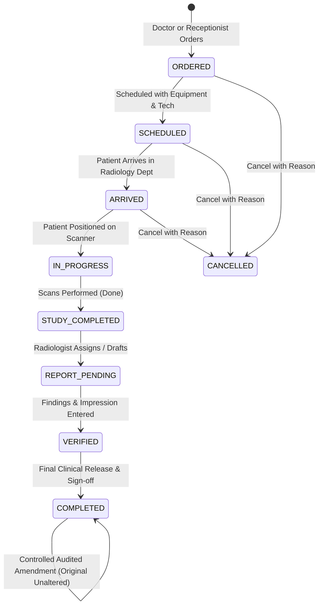

# Radiology Information System (RIS) — Migration Mapping

**Project**: Medora 2.0  
**Phase**: Phase 15  
**Date**: 2026-11-02  
**Author**: Medora Engineering  

---

## 1. Executive Summary

This document details the migration and modernization of the legacy ICTHospital radiology and diagnostic imaging module into Medora 2.0's Radiology Information System (RIS).

In the legacy Laravel system:
- `radiology_exam` represented the diagnostic exam catalogue (exam name, modality, payment category link for price calculation, report template, and active status).
- `radiology_order` represented the patient imaging requisition, capturing patient/doctor/appointment links, exam snapshots, urgency, clinical notes, scheduling/performance timestamps, radiologist findings, impression, and payment link.
- Status transitions: `ordered` -> `scheduled` -> `done` -> `reported` (or `cancelled`).
- Billing was handled via `Billing::raise` linking `payment_id` to `payment_category.c_price`.

Medora 2.0 modernizes this into an enterprise-grade clinical RIS with:
1. **Normalized Catalogue & Modalities**: Structured categories, body parts, preparation instructions, pricing, and report templates across X-ray, Ultrasound, CT, MRI, Mammography, Fluoroscopy, and Interventional imaging.
2. **End-to-End Examination Lifecycle**: Strict 8-stage validated workflow (`ORDERED` -> `SCHEDULED` -> `ARRIVED` -> `IN_PROGRESS` -> `STUDY_COMPLETED` -> `REPORT_PENDING` -> `VERIFIED` -> `COMPLETED`) with cancellation protections.
3. **Conflict-Free Scheduling Engine**: Technologist assignment and equipment room/scanner conflict detection preventing double-booking of imaging resources.
4. **Clinical Findings & Two-Stage Verification**: Structured findings, impression, and recommendations with technologist entry, quality verification, and consultant radiologist sign-off.
5. **Report Immutability & Audited Amendments**: Finalized reports are locked (`400 Bad Request` on direct modification); all post-authorization corrections are tracked via immutable `RadiologyReportAmendment` records with mandatory clinical justification.
6. **Unified Billing Integration**: Seamless transactional synchronization with `InvoiceModule` without duplicate financial ledgers or double-billing.
7. **Granular RBAC Security**: Comprehensive permissions matrix separating ordering physicians, technologists, reporting radiologists, and administrators.

---

## 2. Legacy Table Schema & Medora 2.0 Mapping

### 2.1 Table: `radiology_exam` (Legacy Exam Catalogue)

| Legacy Column | Type | Medora 2.0 Model / Field | Migration & Mapping Strategy |
| :--- | :--- | :--- | :--- |
| `id` | `increments` | `RadiologyExam.id` (`BigInt`) | Auto-incrementing primary key |
| `name` | `varchar(120)` | `name` (`VarChar(120)`) | Examination name (e.g., Chest X-Ray PA View, US Abdomen) |
| `modality` | `varchar(20)` | `modality` (`VarChar(20)`) | Enum/string (`xray`, `ultrasound`, `ct`, `mri`, `mammography`, `fluoroscopy`, `other`) |
| `payment_category_id` | `unsignedInteger` | `paymentCategoryId` (`BigInt?`) | Foreign key to `payment_category.id` (price list service) |
| `report_template` | `text` | `reportTemplate` (`Text?`) | Default boilerplate findings template populated on requisition |
| `active` | `boolean` | `active` (`Boolean`) | Active status flag (default `true`) |
| *New* | - | `code` (`VarChar(30)`) | Unique procedure code (e.g., `RAD-XR-001`, `RAD-US-002`) |
| *New* | - | `bodyPart` (`VarChar(50)?`) | Anatomical region (Chest, Abdomen, Pelvis, Brain, Spine, etc.) |
| *New* | - | `price` (`Decimal(10, 2)?`) | Direct service price fallback |
| *New* | - | `preparationInstructions` (`Text?`) | Patient preparation notes (fasting, bladder fullness, metal removal) |
| *New* | - | `categoryId` (`BigInt?`) | Link to `radiology_category.id` |
| *New* | - | `turnaroundHours` (`Int`) | Expected turnaround time in hours (default 24) |
| `created_at` / `updated_at`| `timestamps` | `createdAt` / `updatedAt` | Timestamptz audit timestamps |

### 2.2 Table: `radiology_order` (Legacy Order & Report)

| Legacy Column | Type | Medora 2.0 Model / Field | Migration & Mapping Strategy |
| :--- | :--- | :--- | :--- |
| `id` | `increments` | `RadiologyOrder.id` (`BigInt`) | Auto-incrementing primary key |
| `patient_id` | `unsignedInteger` | `patientId` (`BigInt`) | Foreign key to `patient.id` |
| `doctor_id` | `unsignedInteger` | `doctorId` (`BigInt?`) | Foreign key to `doctor.id` (referring clinician) |
| `appointment_id` | `unsignedInteger` | `appointmentId` (`BigInt?`) | Foreign key to `appointment.id` (OPD consultation visit) |
| `radiology_exam_id` | `unsignedInteger` | `radiologyExamId` (`BigInt`) | Foreign key to `radiology_exam.id` |
| `name` | `varchar(120)` | `examName` (`VarChar(120)`) | Snapshot of exam name at time of order |
| `modality` | `varchar(20)` | `modality` (`VarChar(20)`) | Snapshot of imaging modality |
| `urgent` | `boolean` | `urgent` (`Boolean`) / `urgency` | Priority flag / urgency level (`routine`, `urgent`, `stat`) |
| `clinical_notes` | `varchar(1000)` | `clinicalIndication` (`Text?`) | Clinical justification / provisional diagnosis from doctor |
| `status` | `varchar(12)` | `status` (`VarChar(30)`) | Validated status lifecycle (`ordered`, `scheduled`, `done`, `reported`, `cancelled`) |
| `scheduled_at` | `dateTime` | `scheduledAt` (`Timestamptz?`) | Scheduled appointment date and time |
| `performed_at` | `dateTime` | `performedAt` (`Timestamptz?`) | Examination completion timestamp |
| `findings` | `text` | `findings` (`Text?`) | Radiologist detailed radiological observations |
| `impression` | `text` | `impression` (`Text?`) | Diagnostic conclusion / summary (mandatory for report release) |
| `reported_by` | `unsignedInteger` | `reportedById` (`BigInt?`) | Foreign key to `users.id` (reporting radiologist) |
| `reported_at` | `dateTime` | `reportedAt` (`Timestamptz?`) | Initial report submission timestamp |
| `payment_id` | `unsignedInteger` | `invoiceId` (`BigInt?`) | Foreign key to `payment.id` (billing invoice) |
| `created_by` | `unsignedInteger` | `createdBy` (`BigInt?`) | User who raised the order |
| *New* | - | `orderNumber` (`VarChar(30)`) | Human-readable unique requisition code (e.g. `RAD-20261102-0001`) |
| *New* | - | `consultationId` (`BigInt?`) | Direct foreign key to `consultation.id` |
| *New* | - | `orderDate` (`Timestamptz`) | Timestamp when order was placed |
| *New* | - | `arrivedAt` (`Timestamptz?`) | Timestamp when patient checked into radiology reception |
| *New* | - | `technologistId` (`BigInt?`) | Imaging technologist who acquired the images |
| *New* | - | `equipmentRoom` (`VarChar(50)?`) | Specific scanner / room (e.g., "CT Room 1", "US Bay 2") |
| *New* | - | `recommendations` (`Text?`) | Follow-up imaging or clinical recommendations |
| *New* | - | `verifiedById` / `verifiedAt` | Quality verification by senior staff |
| *New* | - | `cancelledAt` / `cancelReason` | Audit trail for order cancellation with mandatory reason |

### 2.3 New Table: `radiology_category`

| Column | Type | Constraints | Description |
| :--- | :--- | :--- | :--- |
| `id` | `BigInt` | Primary Key, Autoincrement | Category identifier |
| `name` | `VarChar(100)` | Unique, Not Null | Modality grouping name (e.g. "Computed Tomography", "Ultrasonography") |
| `modality` | `VarChar(20)` | Not Null | Primary modality key (`ct`, `ultrasound`, `xray`, `mri`, etc.) |
| `description` | `Text` | Nullable | Clinical scope description |
| `displayOrder` | `Int` | Default `0` | UI tab ordering priority |
| `isActive` | `Boolean` | Default `true` | Soft deactivation flag |

### 2.4 New Table: `radiology_report_amendment`

| Column | Type | Constraints | Description |
| :--- | :--- | :--- | :--- |
| `id` | `BigInt` | Primary Key, Autoincrement | Amendment record identifier |
| `radiologyOrderId` | `BigInt` | Foreign Key (`radiology_order.id`), Cascade | Linked radiology order |
| `amendedBy` | `BigInt` | Foreign Key (`users.id`), Not Null | Radiologist who issued the amendment |
| `reason` | `Text` | Not Null | Mandatory clinical reason for amendment |
| `previousFindings` | `Text` | Nullable | Snapshot of findings prior to amendment |
| `previousImpression`| `Text` | Nullable | Snapshot of impression prior to amendment |
| `newFindings` | `Text` | Nullable | Revised findings |
| `newImpression` | `Text` | Nullable | Revised impression |
| `createdAt` | `Timestamptz` | Default `now()` | Timestamp amendment was locked |

---

## 3. Radiology Order Lifecycle & State Machine

### Transition Invariants
1. `ORDERED`: Requisition created. Initialized with snapshot of exam details and findings template.
2. `SCHEDULED`: Must supply valid date/time. Equipment room checked for schedule conflicts.
3. `ARRIVED`: Patient physically checked in for scan.
4. `IN_PROGRESS`: Scan acquisition started by assigned technologist.
5. `STUDY_COMPLETED` (or legacy `done`): Scan successfully acquired. Awaiting radiologist report.
6. `VERIFIED` / `REPORTED`: Impression is strictly mandatory. Stamps `reported_by` and `reported_at`.
7. `COMPLETED`: Pathologist/Radiologist final sign-off. Direct record mutation is blocked.
8. `CANCELLED`: Permitted only prior to final reporting. Once `REPORTED`/`COMPLETED`, cancellation is rejected (`400 Bad Request`). Reason is required.

---

## 4. Business Rules & Financial Integration

1. **Auto-Billing & Double-Billing Protection**:
   - Order placement with `bill: true` raises an itemized `Payment` record in `InvoiceModule` with category `'RADIOLOGY'`.
   - If an order already has `invoiceId` (`payment_id`), subsequent billing requests are rejected (`409 Conflict: Already billed on invoice #X`).
2. **Technician & Room Scheduling Collision Prevention**:
   - The scheduling engine validates whether the requested equipment room or assigned technician is already booked during the examination window (default 30-minute slot).
   - Overlapping bookings on the same resource are rejected unless forced with an emergency STAT override.
3. **Report Immutability**:
   - Once an order reaches `reported` or `COMPLETED` status, calling PUT/POST updates on findings/impression without an amendment payload is rejected.
   - Amendments create an append-only audit trail in `radiology_report_amendment`, capturing the author, timestamp, previous snapshot, new text, and mandatory justification.
4. **PACS / DICOM Note**:
   - In accordance with legacy audit findings, no legacy PACS or DICOM server was configured. Imaging assets are stored via structured study metadata and secure hospital file attachments.

---

## 5. Granular RBAC Permissions

| Permission Code | Name | Assigned Roles | Purpose |
| :--- | :--- | :--- | :--- |
| `radiology_view` | View Radiology Worklist & Orders | Admin, Doctor, Nurse, Laboratorist | Read access to orders and schedule |
| `radiology_order` | Order Diagnostic Imaging | Admin, Doctor | CPOE requisition authoring |
| `radiology_schedule` | Schedule Imaging Examinations | Admin, Receptionist, Laboratorist | Booking scanner slots & rooms |
| `radiology_process` | Mark Arrival & Perform Scans | Admin, Laboratorist | Patient check-in and scan acquisition |
| `radiology_result_enter` | Enter Findings & Draft Reports | Admin, Laboratorist | Radiologist reporting workbench |
| `radiology_verify` | Verify & Release Reports | Admin, Laboratorist | Senior radiologist review |
| `radiology_approve` | Final Clinical Release | Admin, Laboratorist | Consultant sign-off |
| `radiology_amend` | Issue Audited Amendments | Admin, Laboratorist | Controlled correction of finalized reports |
| `radiology_catalogue_manage`| Manage Formulary & Equipment | Admin | Catalogue CRUD and pricing configuration |
| `radiology_reports` | Turnaround Time & Statistics | Admin, Doctor, Laboratorist | Departmental analytics & KPI metrics |
