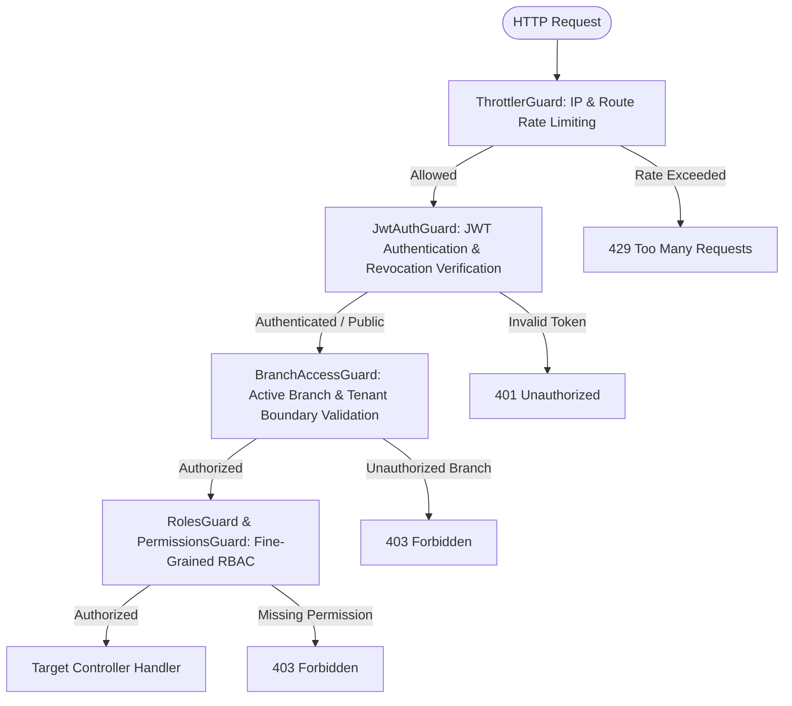

# Medora 2.0 — Security Hardening Architecture & Zero-Trust Boundary Enforcement

**Document Version:** 1.0.0  
**Phase:** Remediation Stage 1  
**Scope:** Production Security Hardening, Multi-Branch Isolation, and Defense-in-Depth  
**Status:** Implemented & Verified  

---

## 1. Executive Architecture Summary

Medora 2.0 is a clinical, administrative, and financial hospital management platform designed to operate safely in multi-facility enterprise deployments. Prior to Stage 1, while tenant and branch models existed in PostgreSQL, critical application endpoints trusted client-supplied identifiers (`branchId`) or omitted global enforcement, resulting in potential cross-facility data leakage.

Stage 1 establishes an auditable, zero-trust security perimeter across both API and persistence layers:
1. **Global Branch Access Enforcement**: Every incoming operational request is intercepted and validated by a globally registered `BranchAccessGuard`.
2. **Object-Level Access Control (OLAC)**: Application services independently assert that the caller possesses legitimate membership and permissions for the target resource's branch before performing read, write, or mutation operations.
3. **Authentication Defense-in-Depth**: Implementation of sliding-window brute-force account lockout (`AccountLockoutService`), anti-enumeration authentication flows, and single-use cryptographically hashed password resets (`PasswordResetService`).
4. **PHI Redaction in Observability Streams**: Transparent interception and sanitization of URLs and query parameters containing patient-identifiable information (CNIC, phone, MRN, search terms) prior to writing to console or application log sinks.
5. **Production Attack-Surface Reduction**: Strict gatekeeping of OpenAPI / Swagger documentation (`/api/docs`), and immediate deprecation/removal of mock and development testing endpoints.

---

## 2. Global Guard Pipeline Architecture

In NestJS, guards registered globally execute sequentially in their declaration order. Stage 1 aligns the guard pipeline as follows:



### Registration Ordering in `app.module.ts`:
```typescript
{
  provide: APP_GUARD,
  useClass: ThrottlerGuard, // 1st: Early rate-limiting defense
},
{
  provide: APP_GUARD,
  useClass: JwtAuthGuard, // 2nd: Authenticates user and populates req.user
},
{
  provide: APP_GUARD,
  useClass: BranchAccessGuard, // 3rd: Enforces branch validation using authenticated req.user
},
```

### Route Decorators:
- `@Public()`: Bypasses authentication and branch checks for public endpoints (e.g. `/api/v1/auth/login`, `/health`).
- `@SkipBranchCheck()`: Bypasses branch requirement for global non-operational endpoints (e.g., `/api/v1/branches/my-branches`, `/api/v1/auth/me`, `/api/v1/auth/change-password`, `/api/v1/notifications`).
- `@OptionalBranch()`: Allows operational fallback if branch is not explicitly provided (e.g., `/api/v1/settings/branding`, `/api/v1/branches`).

---

## 3. Zero-Trust Multi-Branch Authorization Service

The core isolation engine is `BranchAuthorizationService` (`backend/src/common/services/branch-authorization.service.ts`), exported globally from `PrismaModule`:

1. **`isGlobalAdmin(user)`**: Evaluates whether the user possesses enterprise-wide authority (e.g. `Admin` role or explicit `BRANCH_VIEW_ALL` permission).
2. **`resolveAccessibleBranchIds(user)`**: Returns `null` if the user is a global administrator (unrestricted access), or a strongly-typed `bigint[]` of active branch IDs mapped via active `UserBranchMembership` rows and validated home branch assignment.
3. **`assertBranchAccess(user, targetBranchId)`**: Ensures that the target branch exists, is non-deleted, is active, and the user holds an active membership. Throws `ForbiddenException` immediately on violation.
4. **`assertResourceAccess(user, resourceBranchId, resourceType)`**: Performs object-level ownership checks against clinical encounters, consultations, cashier drawers, and accounting ledgers.

---

## 4. Object-Level Access Control (OLAC) Scope

Every migrated module now enforces resource-level ownership:

| Module | Resource / Operation | Authorization Logic |
| :--- | :--- | :--- |
| **PatientModule** | Create, Update, Delete, List | Validates `branchId`. Restricts non-global admins to search within authorized branch scopes. |
| **AppointmentModule** | Booking, Rescheduling, Status, List | Enforces caller membership in `appointment.branchId`. Rejects cross-branch appointments. |
| **ConsultationModule** | Context Workspace, Notes, Printouts | Inherits and asserts access to `appointment.branchId`. Rejects cross-facility clinical inspection. |
| **InvoiceModule** | Billing, Installment Payments, Deletions | Stamps `payment.branchId` on creation. Validates ownership before processing payment installments. |
| **CashierModule** | Shifts, Drawers, Payouts, Day Book | Validates `cashierShift.branchId`. Filters Day Book and shift listings to accessible facilities. |
| **AccountingModule** | Financial Statements, P&L, Balance Sheet, GL | Restricts non-admin accountants to their assigned facility, preventing unauthorized multi-branch disclosure. |
| **DashboardModule** | Comparative Analytics, Caching | Scopes cache keys by user authorization fingerprint and masks financial metrics if permission is absent. |

---

## 5. Defense-in-Depth Authentication & Session Security

1. **Argon2id Primary Hash & Laravel Bcrypt Migration**: Passwords stored as legacy Laravel `$2y$` hashes are validated and automatically re-hashed to Argon2id on successful login.
2. **Brute-Force Account Lockout**:
   - Monitored by `AccountLockoutService`.
   - Threshold: 5 consecutive failed attempts.
   - Sliding Window: 15 minutes.
   - Lockout Duration: 15 minutes.
   - Transparent Auto-Unlock upon expiration; manual supervisor unlock supported.
3. **Secure Password Reset**:
   - `PasswordResetService` generates single-use cryptographically strong tokens (`crypto.randomBytes(32)`).
   - Only SHA-256 hashes of the token are stored in memory with a 15-minute expiration timestamp.
   - Token consumption revokes active refresh tokens and updates the user's password with Argon2id.
   - Endpoint returns uniform HTTP 200 responses to defeat user enumeration.

---

## 6. PHI Redaction & Logging Safety

All request URLs, query parameters, and uncaught exception payloads passing through `LoggingInterceptor` and `AllExceptionsFilter` are processed by `sanitizeLogUrl`:
- Parameters matching `q`, `cnic`, `phone`, `email`, `name`, `token`, `password`, `ssn`, `mrn` are replaced with `[REDACTED]`.
- Correlation IDs (`x-correlation-id`) are retained for end-to-end audit tracing without exposing sensitive health or demographic information.

---

## 7. Production Hardening & Swagger Disablement

In `backend/src/main.ts`:
- Swagger UI (`/api/docs`) is conditionally disabled when `NODE_ENV === 'production'` unless `ENABLE_SWAGGER=true` is explicitly provided in the environment.
- Mock and testing routes in `AuthController` (`test-patient-view`, `test-admin-role`) have been permanently excised.
