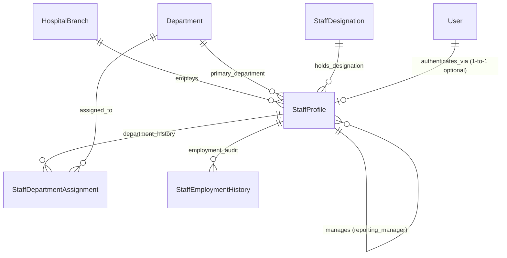

# Phase 19 — Non-Medical Staff Registers & HR Directory Migration Mapping
## Medora 2.0 | Architectural & Database Mapping Specification

**Author**: Medora 2.0 Engineering Team  
**Scope**: Migration of legacy non-medical staff registers (`nurse`, `pharmacist`, `laboratorist`, `receptionist`, `accountant`) into a unified, normalized HR & Staff Directory domain.  
**Target Module**: `StaffModule` (`backend/src/modules/staff/`)  
**Frontend Workspace**: `StaffWorkspace` (`frontend/src/features/staff/StaffWorkspace.tsx`)  
**Prisma Migration**: `20261102220000_phase_19_staff`

---

## 1. Executive Summary & Legacy Audit

In legacy ICTHospital, staff management suffered from extreme denormalization, structural duplication, and absence of human resource controls:
1. **Five Independent Tables of Identical Shape**:
   The system maintained 5 distinct tables (`nurse`, `pharmacist`, `laboratorist`, `receptionist`, `accountant`), each containing:
   `id`, `name`, `email`, `phone`, `address`, `img_url`, `x`, `y`, `z`, `ion_user_id`.
   A single polymorphic controller (`legacy/app/Http/Controllers/StaffController.php`) dynamically selected the model using `config/hospital_staff.php`.
2. **Doctors Kept Separate**:
   Doctors resided in a dedicated `doctor` table due to clinical specialization, departmental assignment, and ICTCore procedure identifiers.
3. **Absence of HR Domain Controls**:
   - No unique employee identifiers (relied only on autoincrement integer row IDs per table).
   - No structured designation catalogue (designation was inferred solely from table name).
   - No department assignment for non-medical staff (nurses and lab techs had no department links).
   - No employment lifecycle (no `ACTIVE`, `ON_LEAVE`, `SUSPENDED`, `TERMINATED` statuses).
   - No joining dates, probation tracking, or emergency contacts.
   - Deleting a staff member executed hard physical row deletion (`$person->delete()`), breaking historical audit integrity.
4. **Loosely Coupled Authentication**:
   `StaffLogin::apply(...)` linked staff records to `users.id` via a string column `ion_user_id`. There were no unique constraints preventing the same user login from being attached to multiple staff records across different tables.

---

## 2. Target Medora 2.0 Database Architecture

Phase 19 introduces a normalized, extensible HR architecture while maintaining full relational compatibility with existing clinical and financial modules:

### A. Entity Relationship Diagram

### B. Core Data Models

1. **`StaffProfile`** (`staff_profile`):
   - **Identifiers**: `id` (BigInt PK), `employeeNumber` (`EMP-YYYYMM-XXXX`, unique, indexed).
   - **Personal Details**: `firstName`, `lastName`, `displayName`, `gender`, `dateOfBirth`, `nationalId` (CNIC).
   - **Contact Information**: `email`, `phone`, `alternatePhone`, `address`, `emergencyContactName`, `emergencyContactPhone`.
   - **Employment Info**: `joiningDate`, `employmentType` (`FULL_TIME`, `PART_TIME`, `CONTRACT`, `PROBATION`, `VISITING`, `INTERN`), `employmentStatus` (`ACTIVE`, `ON_LEAVE`, `SUSPENDED`, `INACTIVE`, `TERMINATED`).
   - **Organizational Links**: `departmentId` (FK -> `department`), `designationId` (FK -> `staff_designation`), `branchId` (FK -> `hospital_branch`), `reportingManagerId` (FK -> `staff_profile`).
   - **Account Binding**: `userId` (FK -> `users`, unique constraint, 1-to-1 optional).
   - **Offboarding Audit**: `offboardedAt`, `offboardingReason`.

2. **`StaffDesignation`** (`staff_designation`):
   - `id` (BigInt PK), `code` (VarChar 50, unique), `title` (VarChar 100), `category` (VarChar 50), `description`, `isActive`.
   - Seeded with standardized categories:
     - `NURSING`: Staff Nurse, Head Nurse, Charge Nurse, ICU Nurse
     - `PHARMACY`: Chief Pharmacist, Staff Pharmacist, Pharmacy Technician
     - `LABORATORY`: Chief Pathologist, Senior Medical Technologist, Lab Technician, Phlebotomist
     - `RECEPTION`: Front Desk Executive, Cashier / Billing Clerk, Admissions Officer
     - `FINANCE`: Chief Accountant, Treasury Officer, Billing Auditor
     - `ADMINISTRATION`: HR Manager, Operations Executive, Hospital Administrator

3. **`StaffDepartmentAssignment`** (`staff_department_assignment`):
   - Multi-department and transfer tracking.
   - Preserves historical transfers (`effectiveStart`, `effectiveEnd`, `reason`, `assignedBy`).

4. **`StaffEmploymentHistory`** (`staff_employment_history`):
   - Append-only audit trail recording: `ONBOARDED`, `TRANSFER`, `DESIGNATION_CHANGE`, `STATUS_CHANGE`, `OFFBOARDED`, `REACTIVATED`.

---

## 3. Employee Number Generation Strategy

Employee numbers follow a standardized, sortable alphanumeric format:
$$\text{EMP}-\text{YYYYMM}-\text{XXXX}$$
- `YYYYMM`: 6-digit year and month of registration.
- `XXXX`: 4-digit sequential zero-padded counter per month.
- Concurrency Safe: Generated with database-level uniqueness and retry entropy to eliminate race conditions during bulk onboarding.

---

## 4. User Account Linking & Offboarding Policy

1. **One-to-One Invariant**:
   A single user account (`users.id`) can be linked to at most one active `StaffProfile`. Attempting to link an already-linked user returns `409 ConflictException: User account is already linked to employee [EMP-XXXX]`.
2. **Optionality**:
   Staff profiles may exist without system login accounts (e.g., support staff, nursing aides, or contractors who do not operate computers).
3. **Decoupled Credentials**:
   `StaffProfile` never stores passwords or authentication tokens. Authentication is strictly delegated to `AuthModule` and `User`.
4. **Offboarding & Historical Preservation**:
   When an employee is offboarded (`TERMINATED` or `INACTIVE`):
   - The staff profile status transitions to `TERMINATED`.
   - `offboardedAt` timestamp and `offboardingReason` are recorded.
   - The associated `User` account has its session revoked, preventing future logins.
   - **CRITICAL INVARIANT**: Historical transactions, cashier shifts, clinical records, dispensed medications, lab verifications, and audit trails created by this user are **NEVER deleted or blanked out**. Database foreign keys remain intact.

---

## 5. Permissions & RBAC Matrix

| Permission | Description | Target Roles |
| :--- | :--- | :--- |
| `STAFF_VIEW` | View staff directory, profiles and organization chart | Admin, Doctor, Receptionist, HR |
| `STAFF_CREATE` | Onboard new staff profiles | Admin, HR Manager |
| `STAFF_UPDATE` | Edit staff personal and contact details | Admin, HR Manager |
| `STAFF_DEACTIVATE` | Set staff to ON_LEAVE, SUSPENDED, or INACTIVE | Admin, HR Manager |
| `STAFF_OFFBOARD` | Terminate employee and trigger account offboarding | Admin, HR Manager |
| `STAFF_ASSIGN_DEPARTMENT` | Transfer staff or update departmental assignments | Admin, HR Manager |
| `STAFF_CHANGE_DESIGNATION` | Promote, demote, or reclassify designation | Admin, HR Manager |
| `STAFF_LINK_USER` | Link or unlink login account to staff profile | Admin |
| `STAFF_VIEW_HISTORY` | View employment and transfer audit logs | Admin, HR Manager |
| `STAFF_REPORTS` | Export staff directory and HR analytics | Admin, HR Manager |

---

## 6. Frontend Workspace Specification

`frontend/src/features/staff/StaffWorkspace.tsx`:
1. **HR Metrics Dashboard**: Total Employees, Active Staff, On Leave, Inactive/Terminated, Department Distribution, Unlinked User Accounts.
2. **Staff Directory**: Fast search (name, employee #, phone, email), filter by Department, Designation, Branch, Status.
3. **Onboarding Modal**: Form for employee details, department, designation, branch, joining date, and optional user linking.
4. **Staff Profile View & Edit Drawer**: Contact information, current assignments, reporting lines, and linked user status.
5. **Department Transfer Workflow**: Formal transfer modal recording effective date and reason, writing to `StaffDepartmentAssignment`.
6. **Offboarding Modal**: Mandatory termination reason and date, applying account security restrictions.
7. **Audit & Employment History**: Timeline of promotions, transfers, and status changes.
