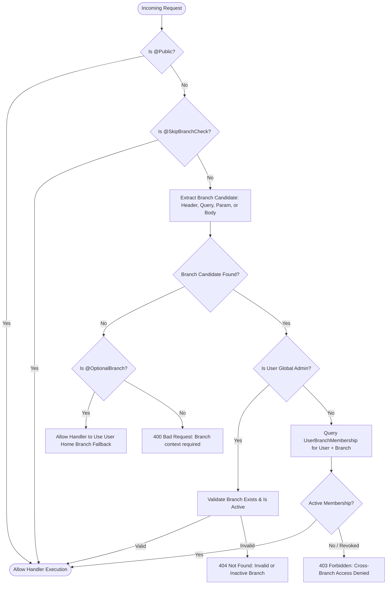

# Zero-Trust Multi-Branch Authorization Guide

**Document Version:** 1.0.0  
**Phase:** Remediation Stage 1  
**Scope:** Multi-Branch Data Isolation & Zero-Trust Enforcement  

---

## 1. Zero-Trust Principle for Multi-Branch Isolation

In Medora 2.0, the presence of a `branchId` in a client HTTP header (`x-branch-id`), query parameter (`?branchId=2`), or request body is never trusted as proof of authorization. Every request undergoes cryptographic authentication followed by server-side branch membership verification.

An actor can interact with resources belonging to branch $B$ if and only if:
1. $B$ is a valid, active, non-deleted `HospitalBranch` record.
2. The user holds an active, non-revoked `UserBranchMembership` record for branch $B$, OR the user is a verified global administrator.

---

## 2. Global Guard: `BranchAccessGuard`

The `BranchAccessGuard` (`backend/src/common/guards/branch-access.guard.ts`) is registered globally as an `APP_GUARD`.



### Route Decorator Reference:
- **`@SkipBranchCheck()`**: Used on cross-branch or global routes that do not operate on facility-scoped clinical/financial records:
  - `GET /api/v1/branches/my-branches`
  - `GET /api/v1/auth/me`
  - `POST /api/v1/auth/change-password`
  - `POST /api/v1/notifications/*`
- **`@OptionalBranch()`**: Used on endpoints that can operate globally or gracefully fall back to the caller's home branch if omitted:
  - `GET /api/v1/branches`
  - `GET /api/v1/settings/branding`
  - `GET /api/v1/hospital-settings`

---

## 3. `BranchAuthorizationService` Implementation

Exported globally from `PrismaModule` (`backend/src/common/services/branch-authorization.service.ts`):

```typescript
@Injectable()
export class BranchAuthorizationService {
  constructor(private readonly prisma: PrismaService) {}

  isGlobalAdmin(user: AuthUser): boolean {
    if (!user) return false;
    if (user.role === 'Admin' || user.group === 'Admin') return true;
    return user.permissions?.includes(HospitalPermission.BRANCH_VIEW_ALL) ?? false;
  }

  async resolveAccessibleBranchIds(user: AuthUser): Promise<bigint[] | null> {
    if (this.isGlobalAdmin(user)) return null;

    const userId = BigInt(user.id);
    const memberships = await this.prisma.userBranchMembership.findMany({
      where: {
        userId,
        isActive: true,
        branch: { active: true, deletedAt: null },
      },
      select: { branchId: true },
    });

    const branchIds = memberships.map((m) => m.branchId);

    if (user.branchId) {
      const homeId = BigInt(user.branchId);
      if (!branchIds.some((id) => id === homeId)) {
        const [homeBranch, revoked] = await Promise.all([
          this.prisma.hospitalBranch.findFirst({
            where: { id: homeId, active: true, deletedAt: null },
            select: { id: true },
          }),
          this.prisma.userBranchMembership.findFirst({
            where: { userId, branchId: homeId, isActive: false },
            select: { id: true },
          }),
        ]);
        if (homeBranch && !revoked) branchIds.push(homeId);
      }
    }

    return branchIds;
  }

  async assertBranchAccess(user: AuthUser, targetBranchId: bigint | number | string): Promise<bigint> {
    const branchIdBigInt = BigInt(String(targetBranchId).trim());

    const branch = await this.prisma.hospitalBranch.findFirst({
      where: { id: branchIdBigInt, active: true, deletedAt: null },
      select: { id: true },
    });
    if (!branch) {
      throw new NotFoundException(`Branch #${targetBranchId} does not exist or is inactive.`);
    }

    if (this.isGlobalAdmin(user)) return branchIdBigInt;

    const accessible = await this.resolveAccessibleBranchIds(user);
    if (!accessible || !accessible.some((id) => id === branchIdBigInt)) {
      throw new ForbiddenException(
        `Access denied: You do not have active authorization for branch #${targetBranchId}.`,
      );
    }

    return branchIdBigInt;
  }

  async assertResourceAccess(
    user: AuthUser,
    resourceBranchId: bigint | number | string | null | undefined,
    resourceName = 'resource',
  ): Promise<void> {
    if (!resourceBranchId) return;
    await this.assertBranchAccess(user, resourceBranchId);
  }
}
```

---

## 4. Frontend Active Branch Handling & Synchronization

In `frontend/src/App.tsx`:
1. **Dynamic Membership Loading**: On authentication, the client calls `GET /api/v1/branches/my-branches` to populate `userBranches`.
2. **Persistence Validation**: If `localStorage.getItem('medora_active_branch')` contains an ID not present in `userBranches`, the frontend immediately discards it and selects the user's primary assigned branch.
3. **Switching Guard**: `handleBranchSelect` validates that any user-initiated branch switch corresponds to an authorized branch.
4. **Session Clearing**: On logout or session expiry, `medora_active_branch` is cleared alongside `medora_access_token`.
